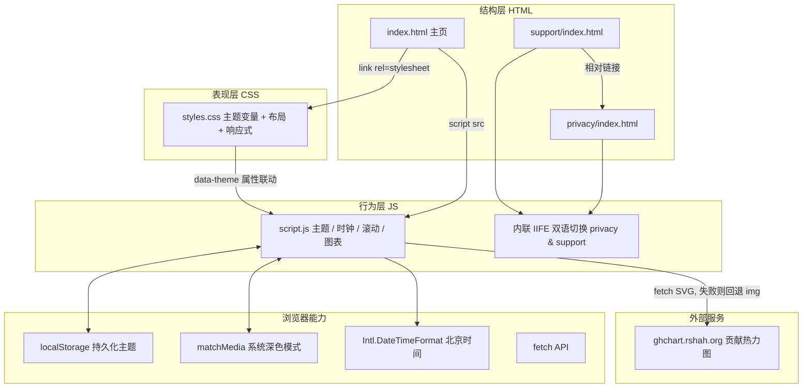
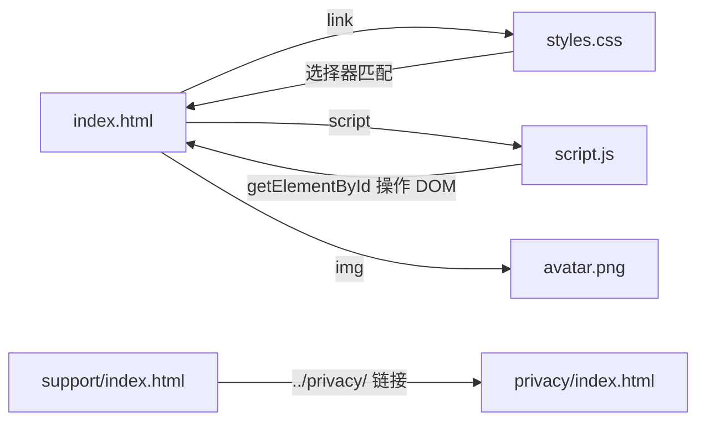

# Code Wiki · mfcheer.github.io

> 个人主页框架（部署于 GitHub Pages），基于 Apple 极简风格设计的纯静态单页站点。
>
> - 仓库地址：<https://github.com/mfcheer/mfcheer.github.io>
> - 线上地址：<https://mfcheer.github.io>
> - 主分支：`main`
> - 文档生成日期：2026-11-03

---

## 目录

1. [项目概述](#1-项目概述)
2. [目录结构与文件清单](#2-目录结构与文件清单)
3. [项目整体架构](#3-项目整体架构)
4. [主要模块职责](#4-主要模块职责)
5. [关键函数与代码逻辑说明](#5-关键函数与代码逻辑说明)
6. [样式系统（styles.css）](#6-样式系统stylescss)
7. [依赖关系](#7-依赖关系)
8. [运行与部署方式](#8-运行与部署方式)
9. [维护指南与已知事项](#9-维护指南与已知事项)

---

## 1. 项目概述

本项目是站主 `mfcheer` 的个人主页，同时兼作 iOS 应用 **TimeNook（时栖）** 的隐私政策与支持页面托管点。

| 维度 | 说明 |
|------|------|
| 项目类型 | 纯静态站点（无构建、无框架、无包管理器） |
| 技术栈 | HTML5 + CSS3 + 原生 JavaScript（ES6+），零外部依赖 |
| 部署方式 | GitHub Pages（推送至 `main` 分支即自动发布） |
| 设计风格 | Apple 极简风：磨砂毛玻璃（backdrop-filter）、大圆角、680px 单栏舒适排版 |
| 核心特性 | 深浅色主题切换（跟随系统 + 手动切换）、实时北京时间、GitHub 贡献图响应式内嵌、平滑锚点滚动、移动端适配 |

页面组成（主页自上而下）：

```
顶部胶囊导航栏（sticky，含主题切换按钮）
   ├── ① 个人简介卡片（#about）    头像 / 职位 / 简介 / 状态标签（含实时北京时间）
   ├── ② GitHub 活跃卡片（#activity） 贡献热力图（ghchart 外部服务）
   ├── ③ 联系卡片（#contact）      Email / 微博链接
   └── 页脚                        版权 + 经纬度坐标 + 回到顶部
```

> 注意：`privacy/` 与 `support/` 两个子页面是为 App Store 审核要求而独立提供的（TimeNook 应用），**并未**在主页中互链，属于并列的独立入口。

---

## 2. 目录结构与文件清单

```
mfcheer.github.io/
├── index.html              # 主页：页面结构与全部内容（106 行）
├── styles.css              # 主页样式：主题变量系统 + 布局 + 响应式（577 行）
├── script.js               # 主页交互逻辑：主题/时钟/滚动/贡献图（111 行）
├── avatar.png              # 头像图片资源
├── privacy/
│   └── index.html          # TimeNook 隐私政策（中英双语切换，自包含）
├── support/
│   └── index.html          # TimeNook 支持页（中英双语切换，自包含）
├── README.md               # 项目简介与本地预览说明
├── COMPLETION_SUMMARY.md   # ⚠️ 历史文档：描述旧版"极客/黑客风格"（已过时，见 §9）
├── .gitignore              # 忽略 .DS_Store / *.swp / *~
└── avatar.png              # （即上方头像资源）
```

| 文件 | 行数 | 职责摘要 |
|------|-----:|----------|
| `index.html` | 106 | 唯一主页入口，语义化结构 + 全部文案内容 + 资源引用（带版本号缓存穿透） |
| `styles.css` | 577 | 三层主题变量体系、毛玻璃卡片、动画、600px 断点响应式、安全区适配 |
| `script.js` | 111 | 主题管理、北京时间每秒刷新、平滑滚动、GitHub 贡献图 SVG 内嵌 |
| `privacy/index.html` | 78 | 独立隐私政策页，内联 CSS/JS，IIFE 实现中英切换 |
| `support/index.html` | 80 | 独立支持页，结构同上，含故障排查指引，链接至 `../privacy/` |
| `avatar.png` | — | 头像位图，约 104 KB |

---

## 3. 项目整体架构

### 3.1 架构总览

本项目为**无构建、无框架**的经典三层静态架构（结构 / 表现 / 行为分离），通过 `<script>` 与 `<link>` 在浏览器端组装：



### 3.2 主题机制数据流

主题系统是本项目最核心的交互逻辑，由 **CSS 变量三层声明** 与 **JS 的 `data-theme` 属性控制** 协同完成：

```
用户首次访问
   │
   ├─ localStorage 有 'theme'？ ── 是 ──► 使用已保存主题（手动选择优先）
   │             │否
   │             ▼
   │     系统偏好深色？(matchMedia prefers-color-scheme: dark)
   │             │
   │      是 ────┴──── 否
   │      ▼                ▼
   │    dark             light
   ▼
applyTheme(theme)：在 <html> 上设置 data-theme 属性
   │
   ├─ CSS 命中 [data-theme="dark"]（或默认 :root 浅色）变量集 → 全站换肤
   └─ 切换按钮图标 🌙/☀️ 与 title 文案更新
```

CSS 侧的三层声明（保证「未手动选择时跟随系统、手动选择后以手动为准」）：

1. `:root` —— 默认浅色变量；
2. `[data-theme="dark"]` —— JS 显式指定深色；
3. `@media (prefers-color-scheme: dark) :root:not([data-theme="light"])` —— 系统深色且用户未强制浅色时兜底。

### 3.3 GitHub 贡献图的双通道加载策略

```
首屏：
        │  （原生图片，保证任何情况下都有内容可显示）
        ▼
JS 异步 fetch 同一 URL
        ├─ 成功且含 <svg> ──► 补 viewBox（响应式）──► innerHTML 替换为内联 SVG
        │                     （内联 SVG 可被 width:100% 缩放，且受深色模式 filter 反色）
        └─ 失败/异常 ──────► 静默降级：保留原  展示
```

---

## 4. 主要模块职责

### 4.1 主页 `index.html`

职责：**结构与内容承载体**，所有文案（简介、联系方式、标签）均硬编码于 HTML 中。

关键结构节点：

| 节点 / 选择器 | 作用 | 被 JS 引用 |
|---------------|------|-----------|
| `#themeToggle`（`button.theme-toggle-btn`） | 主题切换按钮，图标随主题变化 | ✅ 点击切换主题 |
| `#beijingTime`（`.meta-item` 内 span） | 实时北京时间显示位 | ✅ 每秒更新 |
| `#ghChart`（`.gh-chart-container`） | 贡献图容器，初始含 ``，成功后被内联 SVG 替换 | ✅ fetch 替换 |
| `#about` / `#activity` / `#contact` | 三个锚点区块，对应导航链接 | ✅ 平滑滚动目标 |
| `a[href^="#"]` | 所有页内锚点（含 `href="#"` 的品牌与回到顶部） | ✅ 滚动拦截 |

资源引用均带**查询串版本号**用于缓存穿透：`styles.css?v=1.1.0`、`script.js?v=1.1.0`、`avatar.png?v=1.0.8`。

### 4.2 交互逻辑 `script.js`

职责：主页全部动态行为，共 4 个功能块（详见 [§5](#5-关键函数与代码逻辑说明)）：

1. 锚点平滑滚动（事件委托式逐绑定）；
2. 主题管理（读取 / 应用 / 切换 / 跟随系统变化）；
3. 北京时间每秒刷新；
4. GitHub 贡献图异步内嵌与响应式兜底。

### 4.3 样式 `styles.css`

职责：视觉与主题体系（详见 [§6](#6-样式系统stylescss)）。核心是 **CSS 自定义属性（变量）驱动的三层主题**，加上毛玻璃卡片基类 `.glass`、粘性胶囊导航 `.topbar`、600px 移动断点。

### 4.4 子页面 `privacy/` 与 `support/`

职责：为 iOS 应用 **TimeNook（时栖）** 提供合规页面（App Store 审核要求隐私政策可在线访问）。两者均为**自包含单文件**（内联 `<style>` 与 `<script>`），不依赖主站的 styles.css / script.js。

- `privacy/index.html`：隐私政策正文，说明日历权限用途、「不收集/不共享」承诺、本地存储范围、联系方式。
- `support/index.html`：支持页，包含日程不显示排查步骤、纯时钟模式、省电动画说明、问题反馈指引，并通过相对链接 `../privacy/` 指向隐私政策。

两页共用同一套双语切换模式：页面内并列 `<section id="en">` 与 `<section id="zh">`，按钮 `#langToggle` 在两者间切换 `hidden` 属性并互换按钮文案。

### 4.5 静态资源与其他文件

| 文件 | 说明 |
|------|------|
| `avatar.png` | 头像，仅被 `index.html` 引用 |
| `README.md` | 项目简介、特点、本地预览命令 |
| `COMPLETION_SUMMARY.md` | ⚠️ 早期"极客/黑客风格"版本的完成总结（矩阵动画、霓虹绿主题等），**与当前代码已不符**，仅作历史参考 |
| `.gitignore` | 忽略 macOS 系统文件与 vim 临时文件 |

---

## 5. 关键函数与代码逻辑说明

以下为 `script.js` 中全部函数与关键逻辑（主页仅有这一个 JS 文件）。

### 5.1 平滑滚动绑定（第 1–18 行，IIFE 式顶层代码）

```js
document.querySelectorAll('a[href^="#"]').forEach((anchor) => { ... });
```

- 拦截所有页内锚点链接的默认跳转；
- `href="#"`（品牌 logo、回到顶部）→ `window.scrollTo` 平滑回顶；
- 其他锚点 → `target.scrollIntoView({ behavior:'smooth', block:'start' })`，并用 `history.pushState` 写入 URL（不触发浏览器原生跳转）；
- 目标不存在时不做任何事（放行默认行为已被 `preventDefault` 拦截的分支除外）。

### 5.2 主题管理

| 函数 | 签名 | 职责 |
|------|------|------|
| `getPreferredTheme` | `() => 'dark' \| 'light'` | 主题决策：优先 `localStorage.getItem('theme')`；否则读 `matchMedia('(prefers-color-scheme: dark)')` 跟随系统 |
| `applyTheme` | `(theme: string) => void` | 在 `document.documentElement` 上写 `data-theme="dark"/"light"`（驱动 CSS 变量切换），同步更新按钮 emoji（☀️/🌙）与 `title` 提示 |

初始化与交互流程（第 49–66 行）：

```js
let currentTheme = getPreferredTheme();
applyTheme(currentTheme);

themeToggleBtn.addEventListener('click', () => {
    currentTheme = currentTheme === 'dark' ? 'light' : 'dark';
    localStorage.setItem('theme', currentTheme);   // 手动选择后永久生效
    applyTheme(currentTheme);
});

// 系统主题变化时：仅当用户从未手动选择过（localStorage 无 'theme'）才跟随系统
window.matchMedia('(prefers-color-scheme: dark)').addEventListener('change', (e) => {
    if (!localStorage.getItem('theme')) {
        currentTheme = e.matches ? 'dark' : 'light';
        applyTheme(currentTheme);
    }
});
```

### 5.3 `updateBeijingTime`（第 69–90 行）

```js
function updateBeijingTime() { ... }
updateBeijingTime();                 // 立即执行一次
setInterval(updateBeijingTime, 1000); // 每秒刷新
```

- 用 `Intl.DateTimeFormat('zh-CN', { timeZone: 'Asia/Shanghai', hour12: false, ... })` 格式化为 `HH:mm:ss`；
- **容错**：若 `Intl` 时区格式化抛异常（极老浏览器），回退 `now.toTimeString().substring(0, 8)`；
- 元素 `#beijingTime` 不存在时直接 return（防御式编写）。

### 5.4 `loadGitHubChart`（第 93–111 行，async 函数）

```js
async function loadGitHubChart() { ... }
loadGitHubChart();
```

- `fetch('https://ghchart.rshah.org/0071e3/mfcheer')` 获取贡献热力图 SVG 文本；
- 响应 OK 且文本含 `<svg>` 时：若缺少 `viewBox`，注入 `viewBox="0 0 663 104" preserveAspectRatio="xMinYMid meet"`（原点图无 viewBox 无法响应式缩放，663×104 为该服务的固定画布尺寸）；
- 用 `container.innerHTML = svgText` 将容器由 `` 替换为**内联 SVG**，从而：① 可 `width:100%` 自适应；② 可被深色模式的 CSS `filter` 反色处理；
- 整个过程 `try/catch` 包裹，**任何失败都静默降级**到页面上原有的 ``（HTML 中写死的兜底通道），不抛错、不白屏。

### 5.5 子页面内联脚本（privacy / support 共用模式）

```js
(function () {
  var btn = document.getElementById('langToggle');
  var en  = document.getElementById('en');
  var zh  = document.getElementById('zh');
  var zhMode = false;
  function apply() {
    en.hidden = zhMode;            // 显示/隐藏 英文区块
    zh.hidden = !zhMode;           // 显示/隐藏 中文区块
    btn.textContent = zhMode ? 'English' : '简体中文';
  }
  btn.addEventListener('click', function () { zhMode = !zhMode; apply(); });
})();
```

无状态的 IIFE：默认英文，点击按钮在中/英间互斥切换，无持久化。

---

## 6. 样式系统（styles.css）

### 6.1 主题变量体系（核心）

全部颜色、阴影均通过 CSS 自定义属性声明，三处作用域形成完整主题矩阵：

| 作用域 | 触发条件 | 变量集 |
|--------|----------|--------|
| `:root`（第 8–25 行） | 默认（浅色） | 浅色系：`--bg:#f5f5f7`、`--accent:#0071e3` 等 |
| `[data-theme="dark"]`（第 27–44 行） | JS 写入 `data-theme="dark"` | 深色系：`--bg:#0e0e11`、`--accent:#2997ff` 等 |
| `@media (prefers-color-scheme: dark) :root:not([data-theme="light"])`（第 46–65 行） | 系统深色且未显式强制浅色 | 与上一组相同的深色变量（兜底跟随系统） |

关键变量语义：

| 变量 | 用途 |
|------|------|
| `--bg` / `--surface` / `--surface-card` / `--surface-hover` / `--surface-subtle` | 背景 / 毛玻璃卡片面 / 次级卡片面 / 悬停面 / 微弱底色 |
| `--text` / `--text-secondary` / `--muted` | 三级文字灰度 |
| `--line` / `--line-subtle` | 边框线 / 分隔线 |
| `--accent` / `--accent-hover` / `--accent-bg` | 主题蓝（链接、高亮、动作文案） |
| `--shadow` / `--shadow-hover` | 卡片投影（悬停加深） |
| `--topbar-bg` | 顶部导航毛玻璃底色 |

### 6.2 主要组件样式

| 类名 / 区块 | 要点 |
|-------------|------|
| `.page-bg` | `position:fixed; z-index:-1` 的径向渐变氛围背景层，不响应事件 |
| `.container` | `max-width:680px` 单栏居中，全站排版宽度基准 |
| `.topbar` | `position:sticky; top:14px` 胶囊导航（`border-radius:999px`），`backdrop-filter: blur(20px)` 毛玻璃 |
| `.glass` | **毛玻璃卡片基类**：半透明 `--surface` + `blur(20px)` + 22px 圆角 + `--shadow`；主页三大区块共用 |
| `.pulse-dot` | 状态绿点，`pulse-dot-anim` 关键帧 2.5s 呼吸动画（深色模式换用 `#30d158`） |
| `.gh-chart-container` | 贡献图容器：`overflow:hidden; pointer-events:none`（防拖拽选中）；内联 SVG/img 均 `width:100%; height:auto` |
| 深色模式图表反色 | `[data-theme="dark"]` 与系统深色兜底两条规则均对图表加 `filter: invert(0.92) hue-rotate(180deg) brightness(1.1)`（将蓝底白图适配深色界面） |
| `.link-item` | 联系卡片行：悬停 `translateY(-1px)` 上浮 + 边框变主题蓝 |

### 6.3 响应式与安全区

- **断点**：仅一个 —— `@media (max-width: 600px)`，集中收窄内边距、字号、圆角、头像尺寸，页脚改纵向排列；
- **刘海屏/底部安全区**：`@supports (padding-bottom: env(safe-area-inset-bottom))` 为 `.container` 追加底部安全距离；viewport 使用 `viewport-fit=cover`；
- **防溢出**：`html, body { overflow-x:hidden }`，卡片与图表容器均 `min-width:0` 防止 flex/grid 子项撑破。

---

## 7. 依赖关系

### 7.1 内部依赖（文件引用图）



- 主页三件套强耦合：`index.html` 中的 **id 契约**（`themeToggle`、`beijingTime`、`ghChart`）是 JS 与 HTML 的接口，重命名需三处同步；
- `privacy/` 与 `support/` 与主站**零共享**（无公共 CSS/JS），可独立部署与修改。

### 7.2 外部依赖

| 类型 | 名称 | 用途 | 失败影响 |
|------|------|------|----------|
| 运行时外部服务 | `ghchart.rshah.org`（GitHub Contributions chart 服务） | 主页贡献热力图 | 有 `` 兜底，仅损失交互式缩放，不白屏 |
| 字体 | 系统字体栈（`-apple-system, PingFang SC, Microsoft YaHei...`） | 排版 | 无网络字体，天然离线可用 |
| 浏览器 API | `localStorage`、`matchMedia`、`Intl.DateTimeFormat`、`fetch`、`backdrop-filter`、`env(safe-area-inset-*)` | 主题持久化/系统主题/时区时钟/图表抓取/毛玻璃/安全区 | 均有降级或非致命（见 §5.3、§5.4） |

### 7.3 构建/包依赖

**无**。不存在 `package.json`、锁文件、打包器、CSS 预处理器或任何 CI 配置；部署即原样静态托管。

---

## 8. 运行与部署方式

### 8.1 本地预览

方式一（推荐，含完整 fetch 能力）：

```bash
cd 项目根目录
python3 -m http.server 8000
# 浏览器访问 http://localhost:8000
```

方式二：直接双击打开 `index.html`（页面本身可正常渲染；`fetch` 外部图表不受 file:// 限制影响，因为它请求的是 https 外部地址）。

子页面直连地址：

```
http://localhost:8000/privacy/   # 隐私政策
http://localhost:8000/support/   # 支持页
```

### 8.2 部署（GitHub Pages）

仓库已配置为 `mfcheer.github.io` 用户站点，**推送 `main` 分支即自动发布**：

```bash
git add .
git commit -m "feat: 变更说明"
git push origin main
# 数十秒后生效：https://mfcheer.github.io
```

无构建步骤、无环境变量、无密钥。

### 8.3 发布检查清单（修改后建议核对）

- [ ] 若改了 `styles.css` / `script.js` / `avatar.png` 内容，同步更新 `index.html` 中的 `?v=x.x.x` 版本号（缓存穿透）；
- [ ] 保持 `index.html` 中 `themeToggle` / `beijingTime` / `ghChart` 三个 id 不变（JS 依赖）；
- [ ] 新增深色相关样式时，记得同时维护 `[data-theme="dark"]` 与 `prefers-color-scheme` 兜底两处。

---

## 9. 维护指南与已知事项

1. **`COMPLETION_SUMMARY.md` 已过时**：该文件描述的是旧版"极客/黑客风格"站点（霓虹绿、矩阵字符雨、双栏布局），当前代码已是 Apple 极简风格重构后的版本（行数、结构、配色均不一致）。仅作历史档案，勿按其内容理解现仓库。
2. **内容与代码耦合**：简介文案、联系方式、标签全部硬编码在 `index.html` 中，改文案直接改 HTML，无需动 JS。
3. **贡献图服务为第三方**：`ghchart.rshah.org` 为个人维护的免费服务，若失效仅影响贡献图（img 兜底为空），可考虑替换为自建 GitHub API 方案。
4. **`viewBox` 硬编码**：`663×104` 与 ghchart 服务当前画布尺寸绑定，若上游尺寸变化需同步修改 `script.js` 中的常量。
5. **隐私/支持页属于 TimeNook 应用**：修改应用行为（权限、功能）时需同步更新 `privacy/index.html` 的政策描述与生效日期。
6. **主题切换无过渡闪烁问题**：`applyTheme` 在首帧前同步执行（脚本置于 `</body>` 前），且 CSS 有 `transition: background .3s`，体验平滑；若未来把脚本改为 `defer`/`async` 需注意首屏主题闪变。

---

*本文档由代码仓库静态分析生成，覆盖 `main` 分支最新提交（`be7393c feat: 在联系方式中添加微博链接`）。*
