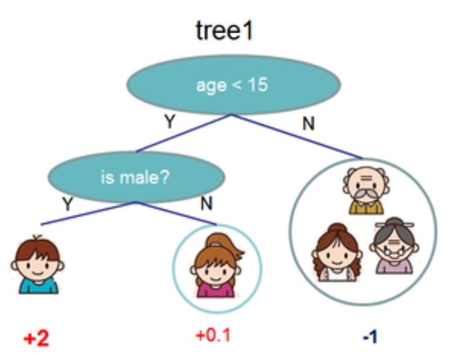
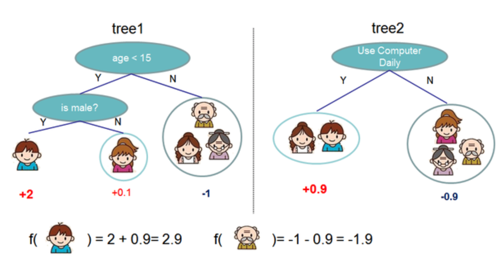
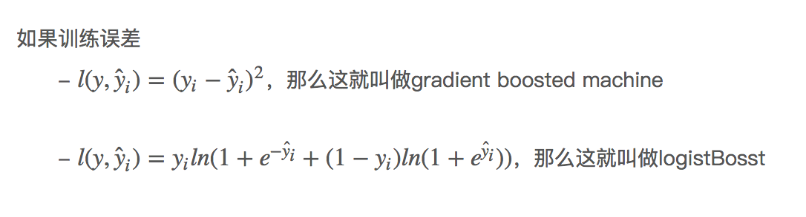
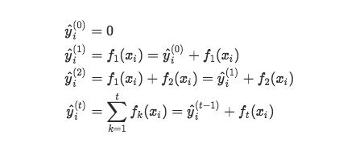
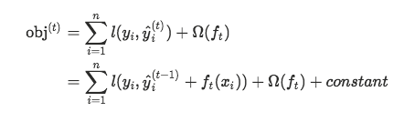
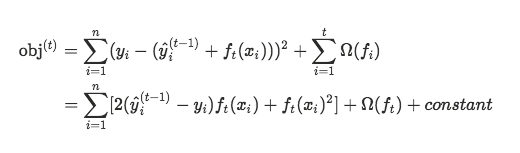
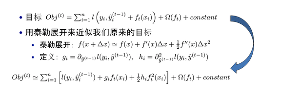
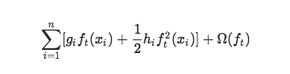
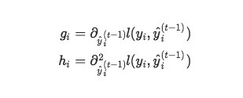

# XGBoost
XGBoost可以看做是GBDT的一种实现方式，目前在竞赛和工业界都被大量应用，并取得了很好的效果。

## BoostedTree
### 回归树
BoostedTree的基本组成部分是回归树（Classification And Regression Tree），称作CART。
回归树会把输入的数据，分配到叶子节点上去，每个叶子节点都对应一个实数，非叶子节点都是一个二叉树。属于决策树的一种。

<!--more-->
决策树自上而下建立，根据属性值大小分裂为左右两个节点。
### TreeEnsemble
一颗回归树往往无法正确的做出预测，所以可以将多棵树的预测进行一个组合，得到最终的结果。
预测结果就是各个回归树的和。

## 模型组成
### 模型和参数
简单来说，模型是指给定xi如何去预测yi.
比较常见的模型如线性模型，yi=w*xi+z,其中w和z就是我们需要预测的值。

### 目标函数=误差函数+正则项

误差函数又称损失函数，是为了尽可能的提高模型预测正确性。一般代表误差，如平方误差等。

正则项是为了防止过拟合样本数据。常见线性模型有L1、L2正则。

## 模型原理
boosting的过程中，每次保留前面的模型不变，加入一个新的函数到模型中，目标函数如下：

每次加入怎样的函数呢？当然是使得目标函数尽量小的函数

如果为平方误差的情形下，目前函数可以写成

对于不是平方误差的情况，我们会采用如下的泰勒展开近似来定义一个近似的目标函数，方便我们进行这一步的计算。

当我们把常数项移除之后，我们会发现如下一个比较统一的目标函数。这一个目标函数有一个非常明显的特点，它只依赖于每个数据点的在误差函数上的一阶导数和二阶导数. 误差函数为

一阶导数、二阶导数为

## 模型参数
### 增加随机性

- eta 为了防止过拟合，更新过程中用到的收缩步长。
- subsample 这个就是随机森林的方式，每次不是取出全部样本，而是有放回地取出部分样本。有人把这个称为行抽取，subsample就表示抽取比例
- colsample_bytree和colsample_bylevel 这个是模仿随机森林的方式，这是列抽取。colsample_bytree是每次准备构造一棵新树时，选取部分特征来构造，colsample_bytree就是抽取比例。colsample_bylevel表示的是每次分割节点时，抽取特征的比例。
- max_delta_step 这个是构造树时，允许得到ft(x)的最大值。如果为0，表示无限制。也是为了后续构造树留出空间，和eta相似

### 控制模型复杂度

- max_depth 树的最大深度
- min_child_weight 叶节点最小样本数
- gamma 每次分开一个节点后，造成的最小下降的分数。类似于上面的Gain
- alpha和lambda就是目标函数里的表示模型复杂度中的L1范数和L2范数前面的系数

### 其他参数
- num_class 分类数
- booster 表示用哪种模型，一共有gbtree, gbline, dart三种选择。一般用gbtree。
- nthread 并行线成数。如果不设置就是能采用的最大线程。
- sketch_eps 这个就是近似算法里的ϵ。
- scale_pos_weight 这个是针对二分类问题时，正负样例的数量差距过大。

## 控制过拟合
通常可以通过两种方式来控制xgboost中的过拟合
- 第一种方式是直接控制模型的复杂性
包括参数：max_depth，min_child_weight 和 gamma
- 第二种方法是增加随机性
包括参数：subsample，colsample_bytree，eta

## 与GBDT的差别
- 传统GBDT以CART作为基分类器，xgboost还支持线性分类器。
- 传统GBDT在优化时只用到一阶导数信息，xgboost则对代价函数进行了二阶泰勒展开，同时用到了一阶和二阶导数。
- xgboost在代价函数里加入了正则项，用于控制模型的复杂度。
- xgboost的权重衰减。
- xgboost支持更好的并行。

# 如何画XGBoost里面的决策树

[如何画XGBoost里面的决策树](<https://zhuanlan.zhihu.com/p/32943164>)

