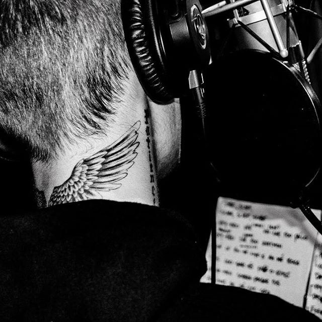
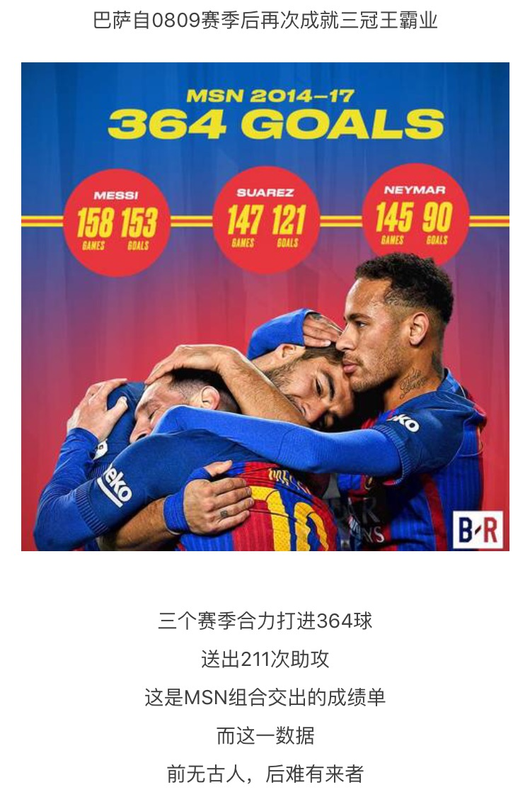
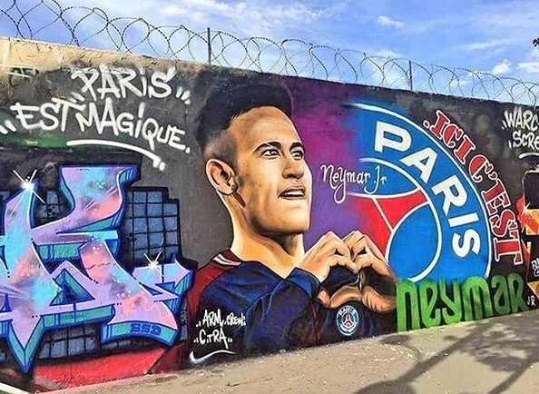

经历了遗憾的两件事

1 justinbieber在中国的世界巡演取消。13年的时候因为当时大一没太多的零花钱，放弃了比伯在国内的演唱会

<!--more-->
2 MSN解散了，内马尔去了巴黎

”攒够钱就能去诺坎普寻找MSN三叉戟“，这是我之前的想法。想不到这么快就破灭了。希望巴塞罗那越来越辉煌，内少早日登上世界之巅。

所以，有机会就要抓住，不要拖。有钱真好，至少在很多情况下有选择的权利。

<!--more-->