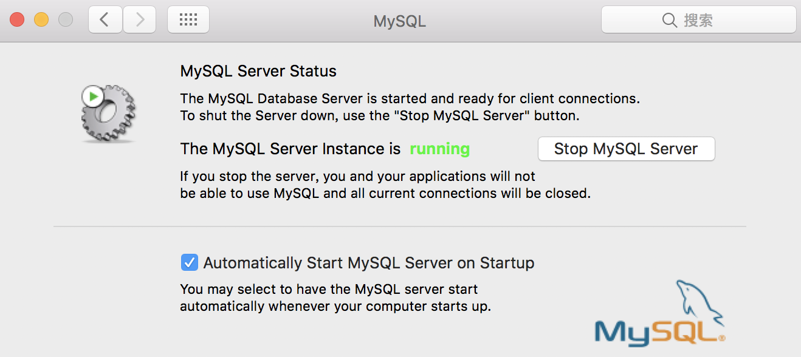
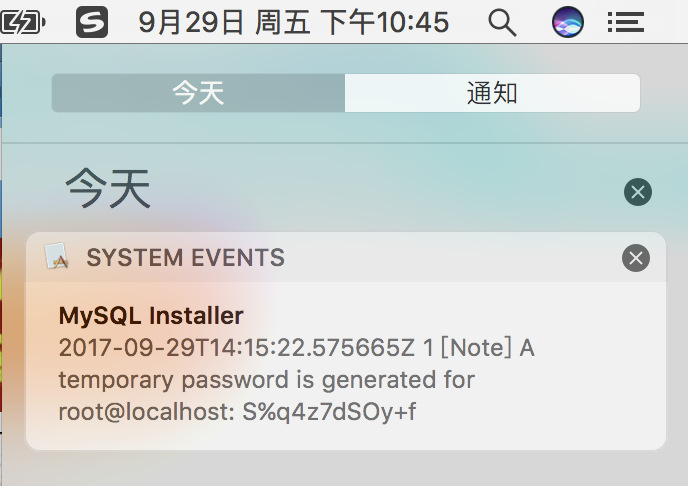

下载地址
[链接](https://cdn.mysql.com//Downloads/MySQL-5.7/mysql-5.7.19-macos10.12-x86_64.dmg)

安装后终端输入
```
mysql --version
```
提示错误
```
mysql command not found
```
这是由于系统默认会查找/usr/bin下的命令，如果命令不在目录下，会找不到，需要映射一个链接到/usr/bin目录下，相当于建立一个链接文件。
首先要知道mysql命令或mysqladmin命令的完整路径，比如mysql的路径是：/usr/local/mysql/bin/mysql，则可以这样执行命令
```
ln -s /usr/local/mysql/bin/mysql /usr/bin
```
<!--more-->
启动mysql
进入系统偏好设置，最下边一行，找到mysql打开，点击"Start MySQL Server"，启动mysql

设置密码
```
sudo mysqladmin -u root -p password newpasswd
```
此时会提示你输入旧密码，旧密码在哪呢？
右侧的通知栏里会有

提示
```
mysqladmin: [Warning] Using a password on the command line interface can be insecure.
Warning: Since password will be sent to server in plain text, use ssl connection to ensure password safety.
```
密码设置成功
登陆
```
mysql -u root -p
```
登陆成功！可以开始刺激了！