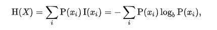

# ID3概念
即Iterative Dichotomiser 3，迭代二叉树3代。该算法是以信息论为基础，以信息熵和信息增益为衡量标准。

## 信息熵
描述信息的混乱程度，熵越大，表示信息越混乱。
信息熵的计算公式：其中P(Xi)表示类别Xi在样本出现的概率。

## 信息增益
用于度量属性A降低样本集合X熵的贡献大小。信息增益越大，越适于对X分类。
Gain(A, X) = H(X) - Sum(|Xv| / |X| * H(Xv))  {v: A的所有可能值}，Xv表示A中所有为v的值；|Xv|表示A中所有为v的值的数量；

# 算法流程
ID3算法就是在每次需要分裂时，计算每个属性的增益率，然后选择增益率最大的属性进行分裂。

# C4.5算法
它是对ID3算法的改进，改进如下

- 1）用信息增益率来选择属性
- 2）在决策树的构造过程中对树进行剪枝
- 3）对非离散数据也能处理
- 4）能够对不完整数据进行处理