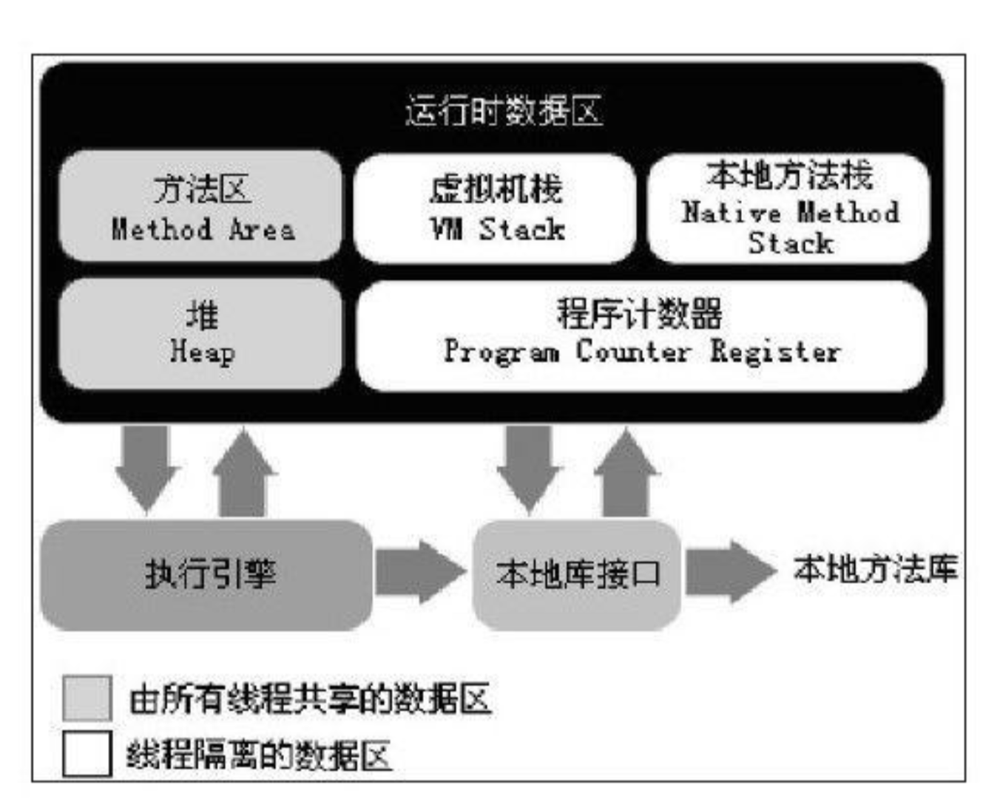

# Java虚拟机运行时数据区
包括如下几部分

## 程序计数器
线程私有内存。用于保存当前正常执行的程序的内存地址。Java虚拟机的多线程就是通过线程轮流切换并分配处理器时间来实现的，为了线程切换后能恢复到正确的位置，每条线程都需要一个独立的程序计数器，互不影响，该区域为“线程私有”。

## 虚拟机栈
线程私有内存，用于存储局部变量表，操作栈，方法返回值。局部变量表放着基本数据类型，还有对象的引用。 

## 本地方法栈
与虚拟机栈一样，只不过服务的是Native方法，也就是调用C、C++代码时。

## Java堆
所有线程共享区域,对象实例几乎都在这分配内存。垃圾回收区域就在此。可细分为新生代和老年代，再可细分为Eden区，From Survivor
区，To Survivor区。用来存储程序中的一些对象，比如你用new关键字创建的对象，它就会被存储在堆内存中，但是这个对象在堆内存中的首地址会存储在栈中。

## 方法区
所有线程共享区域。储存虚拟机加载的类信息，常量，静态变量，编译后的代码。

### 运行时常量池
属于方法区的一部分,代表运行时每个class文件中的常量表。包括几种常量：编译时的数字常量、方法或者域的引用。

# 常用JVM参数
## 栈设置

- -Xss256K:每个线程的栈大小
## 堆设置
- -Xms:初始堆大小
- -Xmx:最大堆大小
- -XX:NewSize=n:设置年轻代大小
- -XX:NewRatio=n:设置年轻代和年老代的比值。如:为3，表示年轻代与年老代比值为1：3，年轻代占整个年轻代年老代和的1/4
- -XX:SurvivorRatio=n:年轻代中Eden区与两个Survivor区的比值。注意Survivor区有两个。如：3，表示Eden：Survivor=3：2，一个Survivor区占整个年轻代的1/5
- -XX:MaxPermSize=n:设置持久代大小

## 收集器设置
- -XX:+UseSerialGC:设置串行收集器
- -XX:+UseParallelGC:设置并行收集器
- -XX:+UseParalledlOldGC:设置并行年老代收集器
- -XX:+UseConcMarkSweepGC:设置并发收集器

## 垃圾回收统计信息

- -XX:+PrintGC
- -XX:+PrintGCDetails
- -XX:+PrintGCTimeStamps
- -Xloggc:filename

## 并行收集器设置
- -XX:ParallelGCThreads=n:设置并行收集器收集时使用的CPU数。并行收集线程数。
- -XX:MaxGCPauseMillis=n:设置并行收集最大暂停时间
- -XX:GCTimeRatio=n:设置垃圾回收时间占程序运行时间的百分比。公式为1/(1+n)
- -XX:+CMSIncrementalMode:设置为增量模式。适用于单CPU情况。
- -XX:ParallelGCThreads=n:设置并发收集器年轻代收集方式为并行收集时，使用的CPU数。并行收集线程数。

# Java new一个对象的过程
- 检测类是否被加载
- 为新生对象分配内存
- 将分配到的内存空间都初始化为零值（不包括对象头）
- 对对象进行必要的设置（例如这个对象是哪个类的实例、如何才能找到类的元数据信息、对象的哈希码、对象的GC分代年龄等信息。这些信息存放在对象的对象头之中）
- 执行init方法（构造方法）

# Java 内存分配原则
- 对象优先分配在Eden区
- 大对象直接进入年老带
- 长期存活对象进入年老带
- 动态对象年龄判断
- 空间分配担保