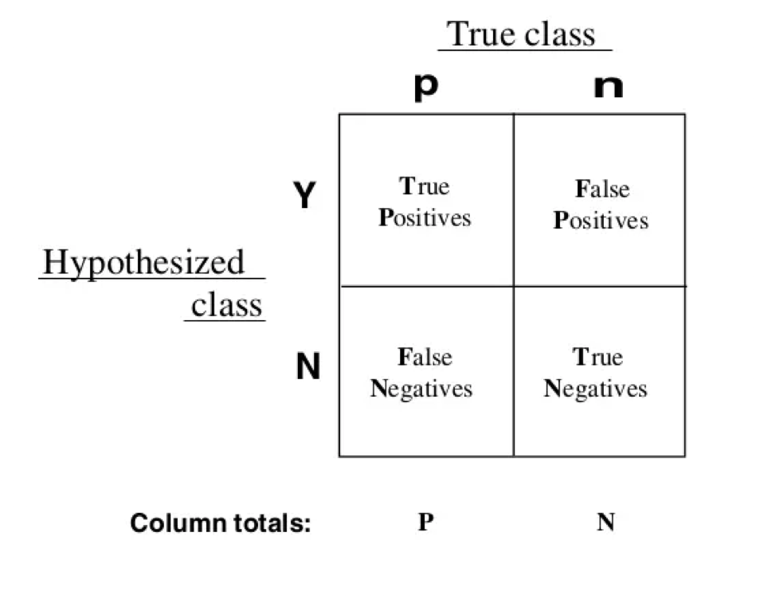
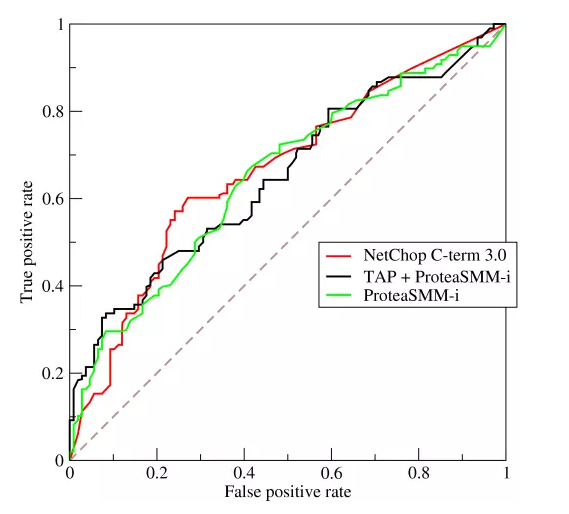

# ROC曲线
Receiver Operating Characteristic curve（受试者工作特征曲线）

我们将二分类器的所有可能取值，做一个方格图如下：

- TP —— True Positive （真正, TP）被模型预测为正的正样本（原来为正预测为正）
- TN —— True Negative（真负 , TN）被模型预测为负的负样本（原来为负预测为负）
- FP ——False Positive （假正, FP）被模型预测为正的负样本（原来为负预测为正）
- FN—— False Negative（假负 , FN）被模型预测为负的正样本 （原来为正预测为负）

TP + TN + FP + FN = 样本总数。
两个指标，准确率和召回率
- 准确率 P = TP/(TP + FP)
- 召回率 R = TP/(TP + FN)

下图为ROC曲线图：

图像的横轴是False Positive rate值（不是FP值），也就是实际为负并且预测错误的个数占总的负值的比例；图像的纵轴是True Positive rate值（不是TP值），也就是实际为正值并且预测正确的个数占总的正值的比例。

## ROC曲线中的“四点一线”
- 第一个点，(0,1)，即FPR=0, TPR=1，这意味着FN（false negative）=0，并且FP（false positive）=0。这是一个完美的分类器，它将所有的样本都正确分类。
- 第二个点，(1,0)，即FPR=1，TPR=0，类似地分析可以发现这是一个最糟糕的分类器，因为它成功避开了所有的正确答案。
- 第三个点，(0,0)，即FPR=TPR=0，即FP（false positive）=TP（true positive）=0，可以发现该分类器预测所有的样本都为负样本（negative）。
- 第四个点（1,1），分类器实际上预测所有的样本都为正样本。

对于ROC曲线，我们可以这样理解，对于二分类问题，曲线的每一个点都代表一个阈值，分类器给每个样本一个得分，得分大于阈值的我们认为是正样本，小于阈值的我们认为是负样本。

- 若学习器A的ROC曲线将另外一个学习器B的曲线完全包住，则A的性能一定比B好
- AUC值等于0.5时，我们可以认为分类器不起作用

# AUC值 
Area Under Curve score (曲线下面积值)，也就是ROC曲线之下与坐标轴围成的面积。
AUC值是一个概率值，当你随机挑选一个正样本以及一个负样本，当前的分类算法根据计算得到的Score值将这个正样本排在负样本前面的概率就是AUC值。AUC值越大，当前的分类算法越有可能将正样本排在负样本前面，即能够更好的分类。

# 下面是觉得不错的相关文章

[乱弹机器学习评估指标AUC](<https://zhuanlan.zhihu.com/p/52930683>)

