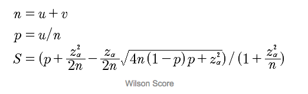

在对物品进行排序时，我们会计算物品的好评度。

进行以下假设
```
1、用户对物品的喜好是相互独立的
2、喜好问题是二分类，喜欢和不喜欢
3、假设好评的概率=点击数/曝光数
```
所以，具有这样特征的分布是二项分布。
<!--more-->

假设A物品曝光10次，被点击9次，B物品曝光1000次，被点击900次。
如果按照点击率排序的话，A和B应该是获得一样分数的。但是B明显是优于A的，因为A样本少不具有说服性，所以需要进行优化。

我们需要计算物品的受欢迎程度，引入[威尔逊区间公式](https://en.wikipedia.org/wiki/Binomial_proportion_confidence_interval#Wilson_score_interval)，对样本数目进行惩罚。


其中u是该物品点击数，v是曝光未点击数，n是曝光数，p是点击率，z是设置的正态分布参数，S是威尔逊分数。
我们可以看到，n足够大的时候，S无限趋于p，n很小时，S远小于p。

这样就解决了样本数目带来的干扰。