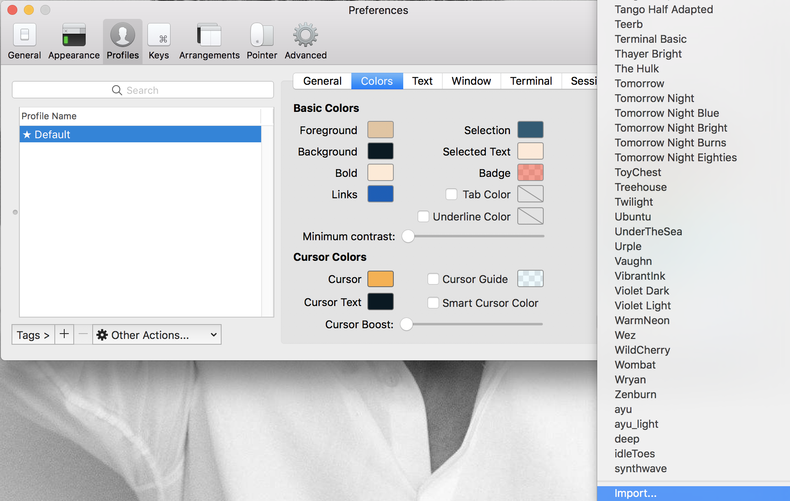

# 下载配色

打开iterm的官方主题配置站  github.com/mbadolato/iTerm2-Color-Schemes，将资源下载至本地,解压。

打开iTerm2，import导入配置。

<!--more-->
# 设置
vim ~/.bash_profile

添加以下代码
``` 
black=$'\[\e[1;30m\]'
red=$'\[\e[1;31m\]'
green=$'\[\e[1;32m\]'
yellow=$'\[\e[1;33m\]'
blue=$'\[\e[1;34m\]'
magenta=$'\[\e[1;35m\]'
cyan=$'\[\e[1;36m\]'
white=$'\[\e[1;37m\]'
normal=$'\[\e[m\]'
PS1="$white[$white@$green\h$white:$cyan\W$yellow\$git_branch$white]\$ $normal"
```

配置生效
source ~/.bash_profile

结束，然后就可以随意切换啦。