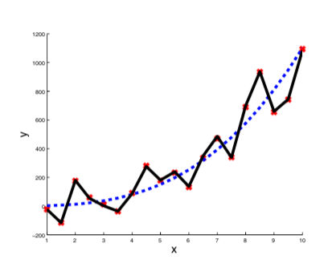
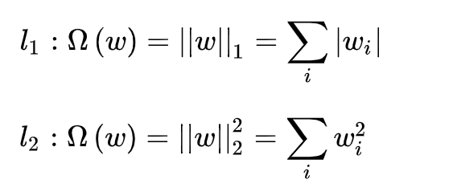
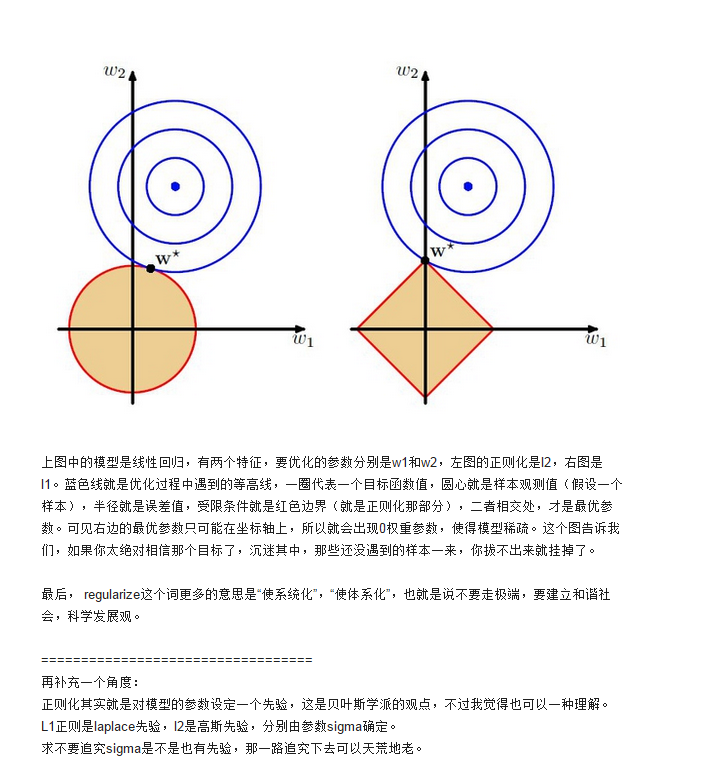

# 正则化概念
是机器学习中一种常用的技术，其主要目的是控制模型复杂度，减小过拟合。最基本的正则化方法是在原目标（代价）函数 中添加惩罚项，对复杂度高的模型进行“惩罚”。

下面图中黑色的折线就是过拟合的例子：

常用的正则化函数有两种，L1正则化和L2正则化

其中，
L1正则化表示某个向量中所有元素绝对值的和。
性质是能产生稀疏性，导致 W 中许多项变成零。会使原最优解的元素产生不同量的偏移，并使某些元素为0或趋近于0。

L2正则化表示某个向量中所有元素平方和再开根， 也就是欧几里得距离公式。
不具有产生稀疏解的能力，计算量上并没有得到提升。 L2正则化的效果是对原最优解的每个元素进行不同比例的放缩。

引用知乎上文章的解释：

上图中，若不加正则项，最优解是靠近中心点的等高线，加入正则项之后，最优解对应的等高线不会离中心太近，避免了过拟合。