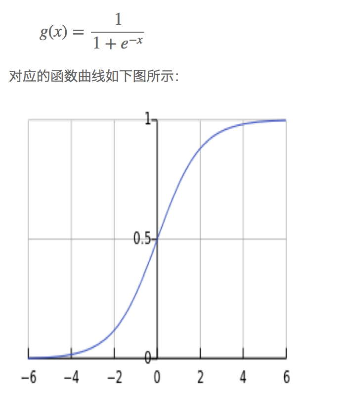

逻辑回归（Logistic Regression）是机器学习中的一种分类模型，用概率的方法预测。
## 损失函数
交叉熵损失函数的推导:
[https://www.cnblogs.com/bonelee/p/7253508.html](https://www.cnblogs.com/bonelee/p/7253508.html)

## 逻辑函数
sigmoid 函数

带入的x为样本的特征向量。

从上图可以看到sigmoid函数是一个严格单调递增的s形的曲线，它的取值在[0, 1]之间，在远离0的地方函数的值会很快接近0/1，收敛速度较快。

## 优点
1) LR是以概率的形式输出结果，不只是0和1的判定； 
2) LR的可解释强，可控性高； 
3) 训练快，feature engineering之后效果赞； 
4) 因为结果是概率，可以做ranking model； 
5) 添加feature简单。 
