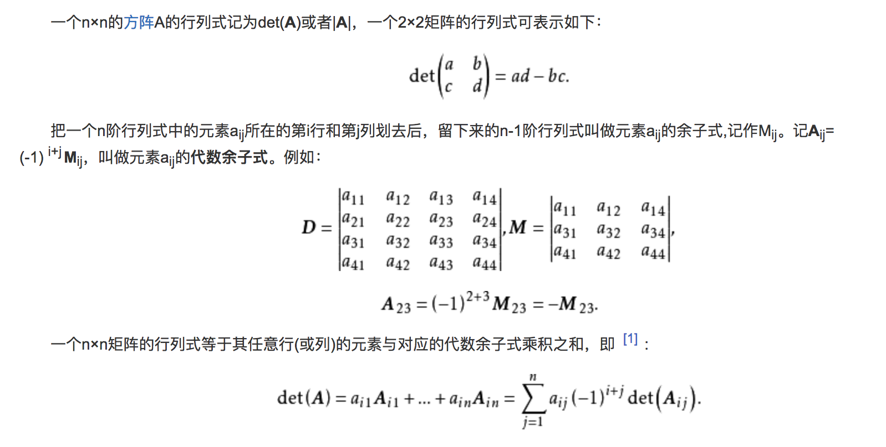

## 矩阵的行列式

## 奇异矩阵
奇异矩阵是线性代数的概念，就是对应的行列式等于0的矩阵。

奇异矩阵的判断方法：首先，看这个矩阵是不是方阵（即行数和列数相等的矩阵。若行数和列数不相等，那就谈不上奇异矩阵和非奇异矩阵）。 然后，再看此方阵的行列式|A|是否等于0，若等于0，称矩阵A为奇异矩阵；若不等于0，称矩阵A为非奇异矩阵。 同时，由|A|≠0可知矩阵A可逆，这样可以得出另外一个重要结论:可逆矩阵就是非奇异矩阵，非奇异矩阵也是可逆矩阵。
<!--more-->
## 非奇异矩阵
n 阶方阵 A 是非奇异矩阵的充要条件是 A 可逆，即可逆方阵就是非奇异矩阵。
## 单位矩阵
在矩阵的乘法中，有一种矩阵起着特殊的作用，如同数的乘法中的1，这种矩阵被称为单位矩阵。它是个方阵，从左上角到右下角的对角线（称为主对角线）上的元素均为1。除此以外全都为0。
## 逆矩阵
设A是数域上的一个n阶方阵，若在相同数域上存在另一个n阶矩阵B，使得： AB=BA=E ，则我们称B是A的逆矩阵，而A则被称为可逆矩阵。注：E为单位矩阵。
A的逆矩阵记作A-1。
## 矩阵转置
设A为m×n阶矩阵（即m行n列），第i 行j 列的元素是a(i,j)，即：A=a(i,j)
定义A的转置为这样一个n×m阶矩阵B，满足B=a(j,i)，即 b (i,j)=a (j,i)（B的第i行第j列元素是A的第j行第i列元素），记A'=B。(有些书记为A^T，这里T为A的上标）

