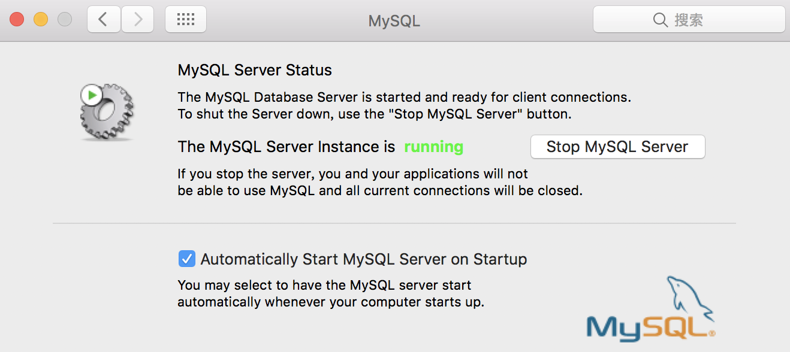

hexo建站步骤：http://www.jianshu.com/p/e99ed60390a8

每次部署的步骤，可按以下三步来进行。

```
hexo clean
hexo generate
hexo deploy
```

常用命令：

```
hexo new "postName" #新建文章
hexo new page "pageName" #新建页面
hexo generate #生成静态页面至public目录
hexo server #开启预览访问端口（默认端口4000，'ctrl + c'关闭server）
hexo deploy #将.deploy目录部署到GitHub
hexo help  #查看帮助
hexo version  #查看Hexo的版本
```

<!--more-->
文章在 source/_posts，编辑器可以用 Sublime，支持 markdown 语法。如果想修改头像可以直接在主题的 _config.yml 文件里面修改，友情链接，之类的都在这里，修改名字在 public/index.html 里修改

文章链接设置，避免出现中文：

```
_config.yml中添加：
permalink: :year:month:day-:urlname.html
permalink_defaults: 
  urlname: index
文章中添加：
urlname: hexo_permalink
```

换电脑时，只需要拷贝下面几个文件：
```
_config.yml
 package.json
 scaffolds/
 source/
 themes/
```

Markdown使用方法：http://www.appinn.com/markdown/#p

MarkDowm常用
```
图片：
链接：[链接](https://www.xxx.com)
```
添加disqus评论
```
1、注册https://disqus.com
2、根目录下的config.yml, 添加disqus_shortname: your_disqus_short_name
```
添加访问统计
[链接](http://www.jianshu.com/p/8a8f880f40c0)

Hexo备份
[https://github.com/coneycode/hexo-git-backup](https://github.com/coneycode/hexo-git-backup)

[添加搜索功能](https://gitee.com/sjclub/hexo-search-plugin)

[文章日历](https://cndrew.cn/2020/03/03/calender/)

[说说](https://artitalk.js.org/doc.html#%F0%9F%95%B8-jsdelivr)

douban需要的node版本v10.14.2
