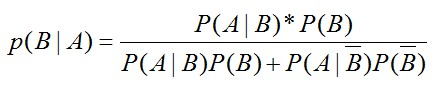
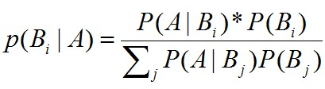
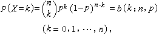
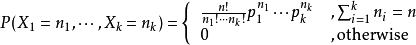
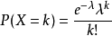
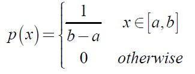
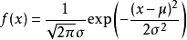

# 概率论
## 全概率公式
对一复杂事件A的概率求解问题转化为了在不同情况下发生的简单事件的概率的求和问题。如果事件B1、B2、B3…Bn 构成一个完备事件组，即它们两两互不相容，其和为全集；并且P(Bi)大于0，则对任一事件A有 P(A)=P(A|B1)*P(B1) + P(A|B2)*P(B2) + ... + P(A|Bn)*P(Bn).

## 贝叶斯公式
贝叶斯公式用来描述两个条件概率之间的关系，比如 P(A|B) 和 P(B|A)。按照乘法法则：P(A∩B)=P(A)*P(B|A)=P(B)*P(A|B)，可以立刻导出。如上公式也可变形为：P(B|A)=P(A|B)*P(B)/P(A)。而其中的P(A)可以由全概率公式展开。得到最终的贝叶斯公式

如果B事件是有多个独立子事件构成，那么公式如下：

<!--more-->
## 常见离散型分布
### Bernoulli分布
又名两点分布或者0-1分布。若Bernoulli试验成功，则Bernoulli随机变量X取值为1，否则X为0。记试验成功概率为θ，即P(X=1)=θ,p(X=0)=1-θ。均值μ=θ，方差 =θ(1-θ)

### 二项分布
二项分布即重复n次独立的伯努利试验。在每次试验中只有两种可能的结果，而且两种结果发生与否互相对立，并且相互独立，与其它各次试验结果无关，事件发生与否的概率在每一次独立试验中都保持不变，则这一系列试验总称为n重伯努利实验

### 多项分布
把二项分布公式推广至多种状态，就得到了多项分布。例如1出现k1次，2出现k2次，3出现k3次的概率分布情况。

### 泊松分布
这个分布是S.-D.泊松研究二项分布的渐近公式时提出来的。泊松分布P (λ)中只有一个参数λ ，它既是泊松分布的均值，也是泊松分布的方差。在实际事例中，当一个随机事件，例如某电话交换台收到的呼叫、来到某公共汽车站的乘客、某放射性物质发射出的粒子、显微镜下某区域中的白血球等等，以固定的平均瞬时速率λ(或称密度)随机且独立地出现时，那么这个事件在单位时间（面积或体积）内出现的次数或个数就近似地服从泊松分布。

## 常见连续型分布
### 均匀分布
随机变量X在区间[a,b]上均匀分布。


### 高斯分布
对模型残差或噪声能很好建模。


### t分布，laplace分布，gamma分布，beta分布
Laplace分布：相比于高斯分布，Laplace分布更集中有均值附近。
Gamma分布：a为形状参数，b为比率度参数
Beta分布：beta分布的支持区间为[0,1]
## 弱大数定律和中心极限定理
独立同分布的随机变量序列X1,x2,...,Xn，E(Xi)=u,方差σ2，则样本均值依概率收敛于期望u。即

中心极限定理：设从均值为μ、方差为σ^2;（有限）的任意一个总体中抽取样本量为n的样本，当n充分大时，样本均值的抽样分布近似服从均值为μ、方差为σ^2/n 的正态分布。
## 极大似然估计
极大似然估计是建立在这样的思想上：已知某个参数能使这个样本出现的概率最大，我们当然不会再去选择其他小概率的样本，所以干脆就把这个参数作为估计的真实值。

求极大似然函数估计值的一般步骤：

```
（1） 写出似然函数，即每个随机实验出现概率相乘，为这个抽样出现的概率。
（2） 对似然函数取对数，为了方便求导；
（3） 对参数求导数。
（4） 令导数=0，即求解极值，由实际情况知，该极值为极大值。解似然方程。
```
