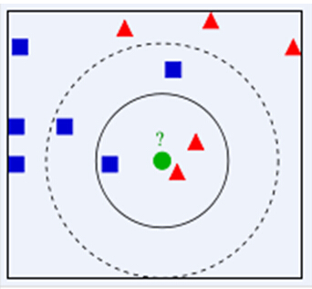

KNN（K Nearest Neighbor）算法是机器学习里面常用的一种分类算法，假设一个样本空间被分为几类，然后给定一个待分类所有的特征数据，通过计算距离该数据的最近的K个样本来判断这个数据属于哪一类。如果距离待分类属性最近的K个类大多数都属于某一个特定的类，那么这个待分类的数据也就属于这个类。

如图所示，假设现在需要对中间绿色的圆进行分类，假设我们寻找距离这个绿色圆最近的3个样本，即K=3，那么可以看出这个绿色圆属于红色三角形所在的类；如果K=5，因为蓝色方框最多，所以此时绿色圆属于蓝色方框所在的类。从而得到当K值取值不同时，得到的分类结果也可能不一样，所以很多时候K值得选取很关键，这就是KNN的核心思想。如果类别个数为偶数，那么K通常会设置为一个奇数；如果类别个数为奇数，K通常设置为偶数，这样就能保证不会有平局的发生。

每预测一个新样本的所属类别时，都会对整体样本进行遍历，可以看出KNN的效率实际上是十分低下的。
<!--more-->
