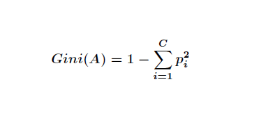
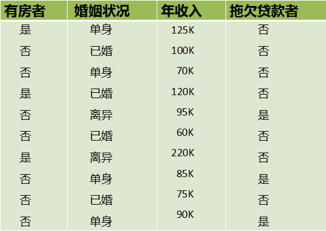
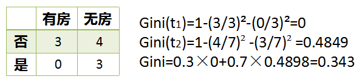
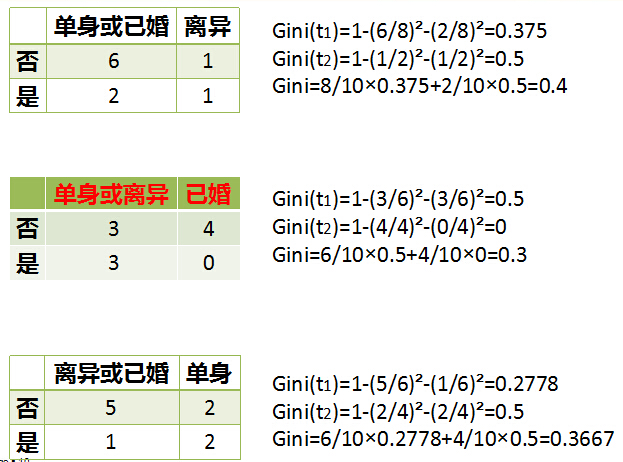
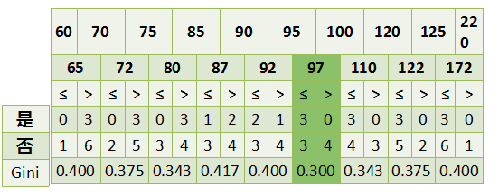

# CART算法概念
Classification And Regression Tree，即分类回归树算法。它是决策树的一种实现。

CART是一种二分的分割技术，把当前的样本划分成两个子样本，每个非叶子节点都有两个分支，生成的决策树是二叉树。

# CART算法流程

使用基尼系数判断样本集的“不纯度”，尽可能“纯”就是尽量让一个分裂子集中待分类项属于同一类别。基尼系数越低越好。

基尼系数的公式：
其中，C样本分类的数量。Pi表示属于i类的概率。

下面举例CART中基尼系数的计算，图片来自网络。

属性有3个，分别是有房情况，婚姻状况和年收入。房和婚姻是离散值，收入是连续值，是否贷款是分类结果。

下面是婚姻状况属性，有三种情况。

最后是收入属性，它是连续值，连续值的计算使用分裂点的方法，选择基尼系数最小的点作为决策树的划分。

根据这样的分裂规则CART算法就能完成建树过程。