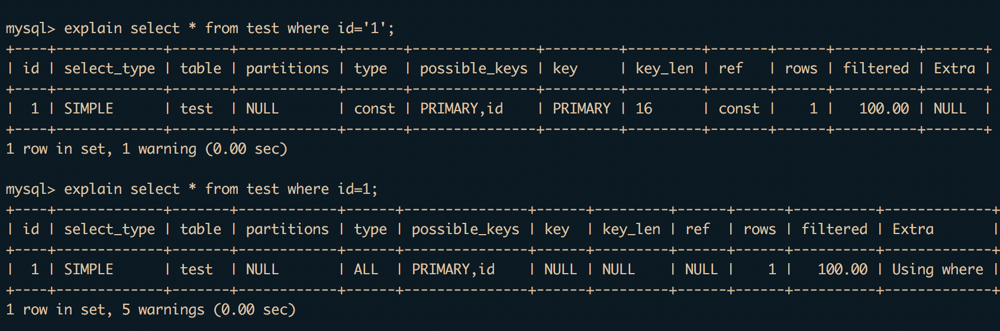

对于这样一张表
```
+-------+----------+------+-----+---------+-------+
| Field | Type     | Null | Key | Default | Extra |
+-------+----------+------+-----+---------+-------+
| id    | char(16) | NO   | PRI | NULL    |       |
| name  | char(16) | YES  |     | NULL    |       |
+-------+----------+------+-----+---------+-------+
```
两个查询语句
``` sql
select * from test where id='1';
select * from test where id=1;
```
有什么区别吗？答案是有的



关键在于type上
<!--more-->
```
使用字符串类型查找的type是const，用的是索引
使用数字查找的type是ALL，也就是全表扫描
```
使用数字的时候没有用到索引，使用单引号的时候用到了索引。所以数据量较大时，在效率上会有很大的差别！
mysql不会自动把数字转成字符串，而是把每个查询到的结果转成了数字去比较。
所以平时使用的时候要注意语法规则！
