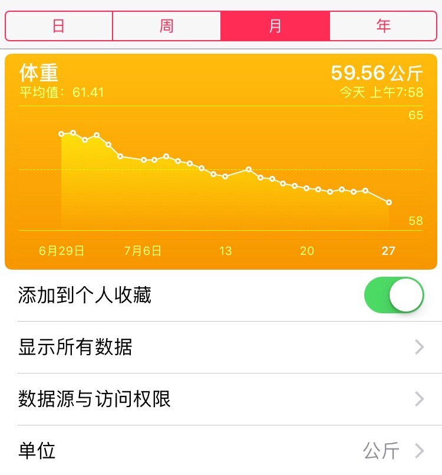
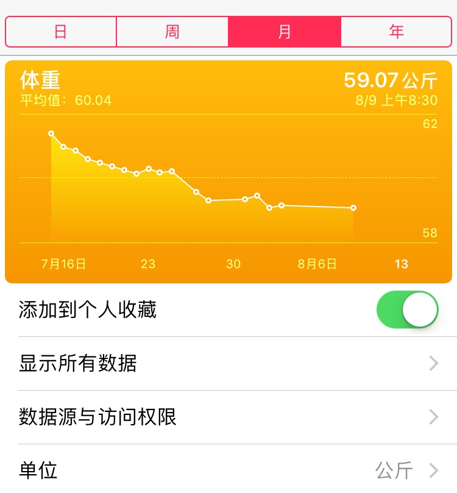

七月初开始对身材进行控制。一个月的时间瘦了近10斤。前一个月采用的方式是控制饮食+跑步。

<!--more-->

但是到了后期，感觉到了瓶颈。饮食稍微不控制，就没什么效果，跑步太多对膝盖也有伤害。毕竟美食是人生一大乐趣，所以尝试了有氧。

天猫买了一桶蛋白粉，一对哑铃，开练！飞鸟，卧推，卷腹...在家跟着视频教材练习，饮食比之前摄入的热量多了，但是10多天下来感觉到身体维度的变化，体重也有略微下降，因为肌肉量增加，会提高人体的基础代谢，所以有氧的方式是科学的。

继续坚持几个月看效果！

<!--more-->