# 基础概念
简单来说，
仓库是存储镜像的地方
镜像是一个包含配置和运行环境的文件系统
容器是镜像的一个实体，一个镜像可生成多个容器
# 下载安装
mac下docker下载及入门
[官网](https://docs.docker.com/docker-for-mac/)

下载dmg文件后按步骤安装
运行docker命令查看是否安装成功
```
docker --version
Docker version 17.09.0-ce, build afdb6d4
```

docker执行pull的时候出现超时,改为使用国内的仓库
```
echo "DOCKER_OPTS=\"\$DOCKER_OPTS --registry-mirror=http://f2d6cb40.m.daocloud.io\"" | sudo tee -a /etc/default/docker
```
# 实践
## 例子1
helloworld
下载一个镜像

```
docker pull hello-world
```

下载成功后查看镜像信息

```
docker images hello-world
```

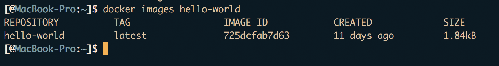

<!--more-->
制作一个容器
```
docker run hello-world
```
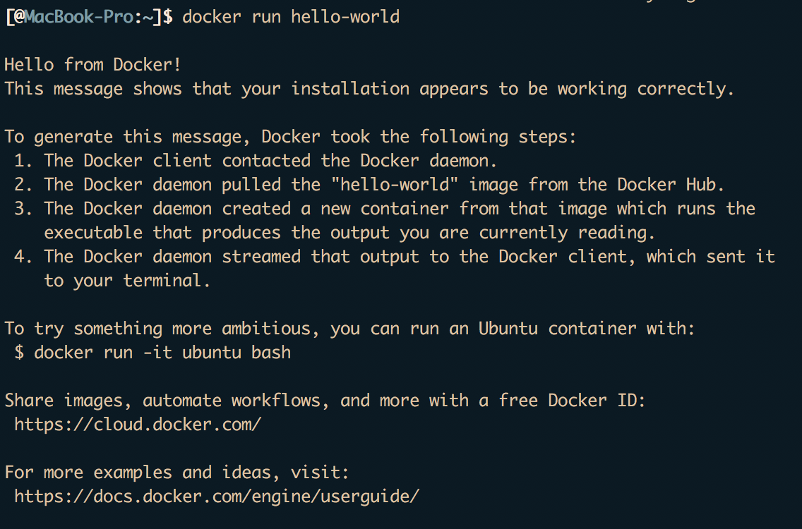
查看所有容器
```
docker ps -a
```
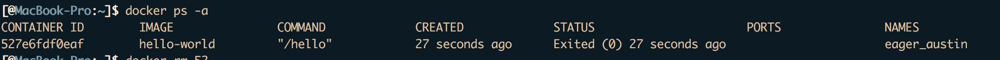

删除容器
```
docker rm id
```
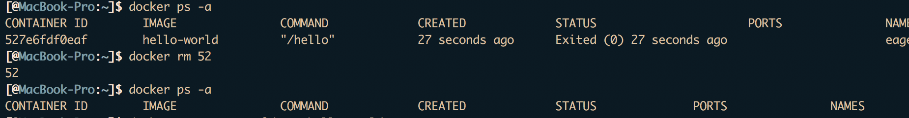

## 例子2
docker的web服务
```
docker pull nginx
docker run -d -p 80:80 --name webserver nginx
```
访问80端口
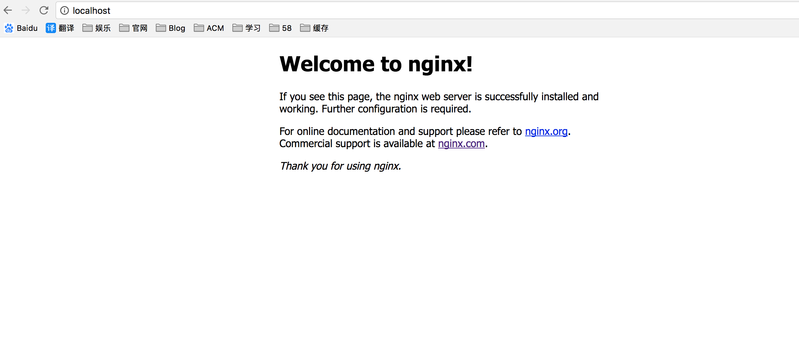
进入docker容器
```
docker exec -it webserver bash
```
修改网页
```
echo '<h1>Hello, Docker!</h1>' > /usr/share/nginx/html/index.html
```
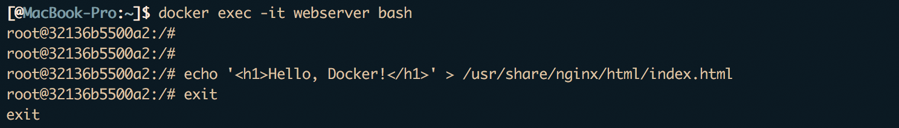
再次访问80端口
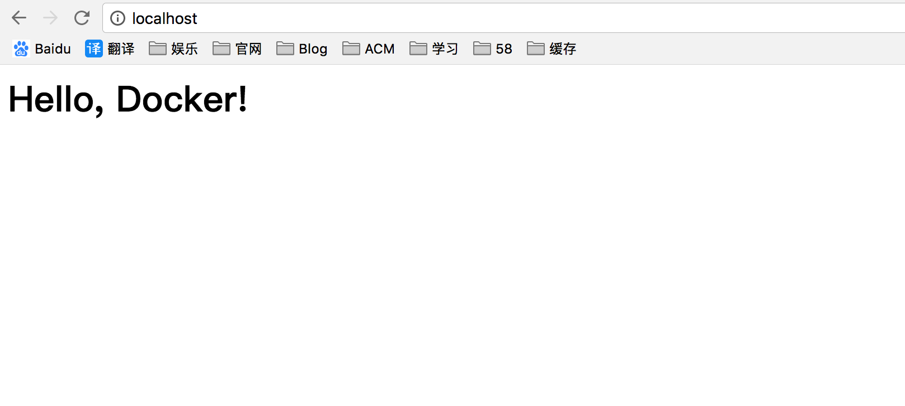
修改了容器的内容，查看不同，和svn类似
```
docker diff webserver
```
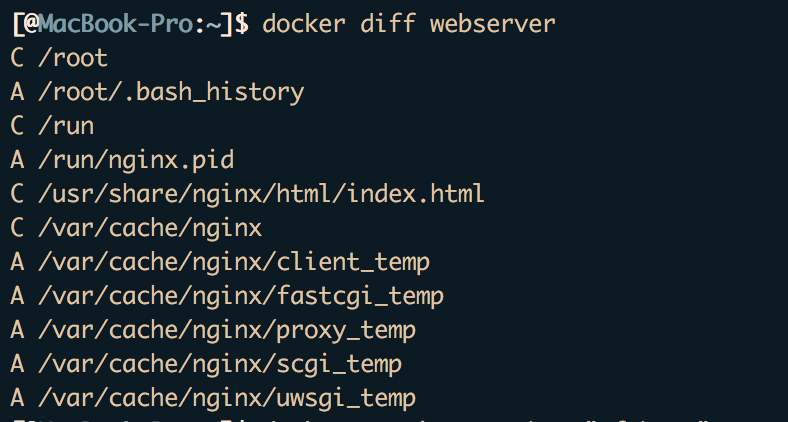

生成新的镜像
```
docker commit --author "mfcheer" --message "修改了默认网页" webserver nginx:v2
```
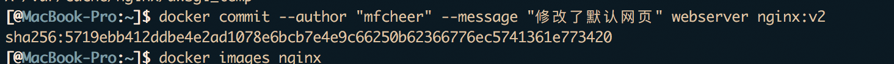
查看当前nginx镜像
```
docker images nginx
```
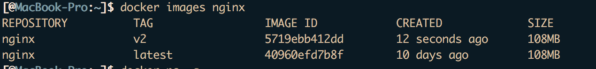
查看所有容器
```
docker ps -a
```
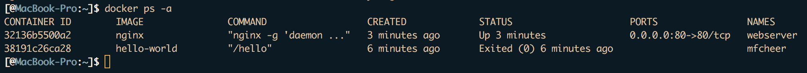