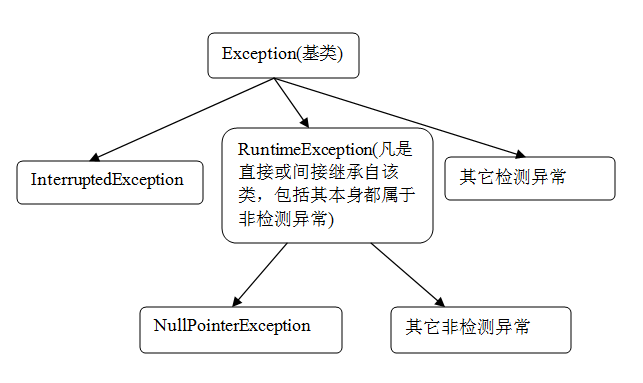

## 概念
异常 是在程序执行期间发生的破坏正常的程序指令流的事件。异常处理是 Java 编程的一项基础技术。您将代码包装在一个 try 代码块中（这表示 “尝试此代码并让我知道它是否导致了异常”），并使用它捕获 (catch) 各种类型的异常。

## 异常分层
异常分层结构

Java 语言包含一个完整的异常分层结构，它由许多类型的异常组成，这些异常划分为两大主要类别：
- 已检查的异常已由编译器检查（表示编译器确定它们已在您代码中的某处处理过）。一般而言，这些异常是 java.lang.Exception 的直接子类。
- 未检查的异常（也称为运行时异常）未由编译器检查。这些是 java.lang.RuntimeException 的子类。

程序导致异常时，您可以说它抛出了 异常。已检查的异常可由任何方法在方法名中包含 throws 关键字来声明。后跟该方法可能在执行期间抛出的异常的逗号分隔列表。如果代码调用的一个方法指定它抛出一种或多种类型的异常，您必须对它进行一定的处理，或者向方法名中添加一个 throws 来传递该异常类型。

## 多个catch代码块
可以拥有多个 catch代码块，但必须采用某种特定方式来搭建它们。如果所有异常都是其他异常的子类，那么子类会按照 catch 代码块的顺序放在父类前面。
<!--more-->
