前几周就想来天津玩，看权健的比赛。找了几次也没有找到志同的人。昨天在朋友圈看到同事去天津了，哇哇哇，不能把自己的事束缚在别人身上吧，所以今天一个人来天津了

简单的记录一下今天的天津之旅，整个过程还是值得推荐的

9.30出发，21.00返程

天津的建筑很有特色，街道很整洁。
首先到了天津站，外面就是海河，每隔几百米就有一座桥，沿着河走了一会，两侧的建筑和桥都很美

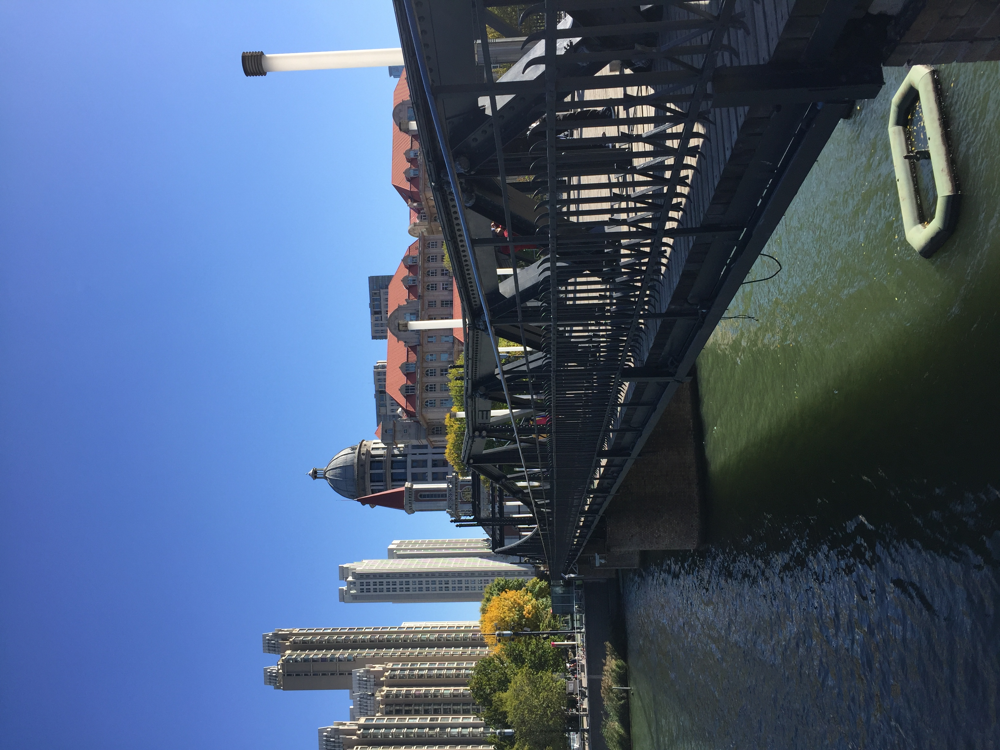
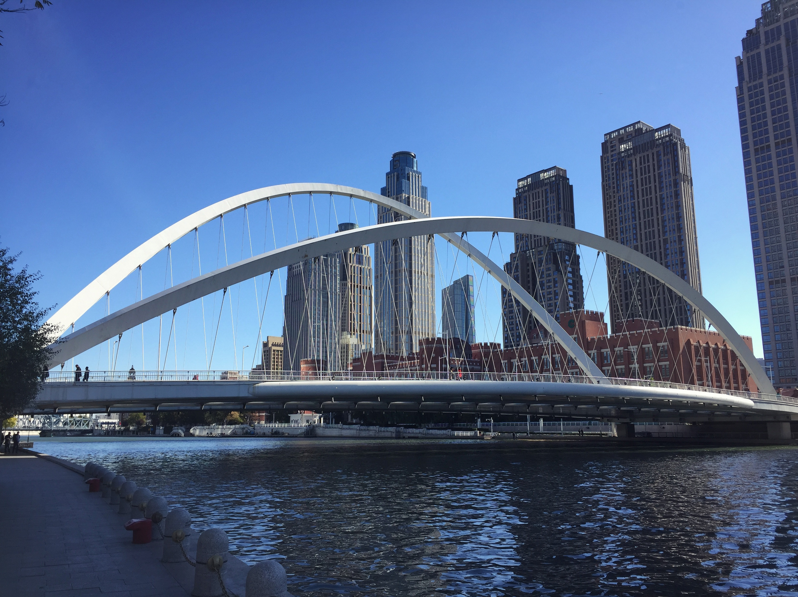
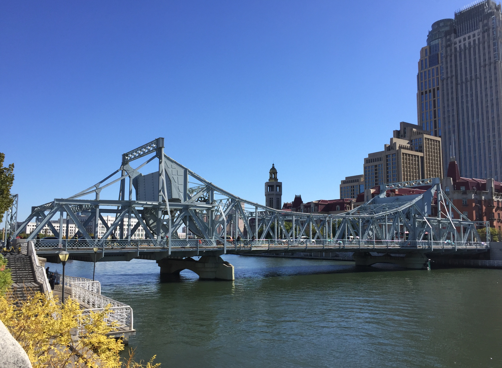
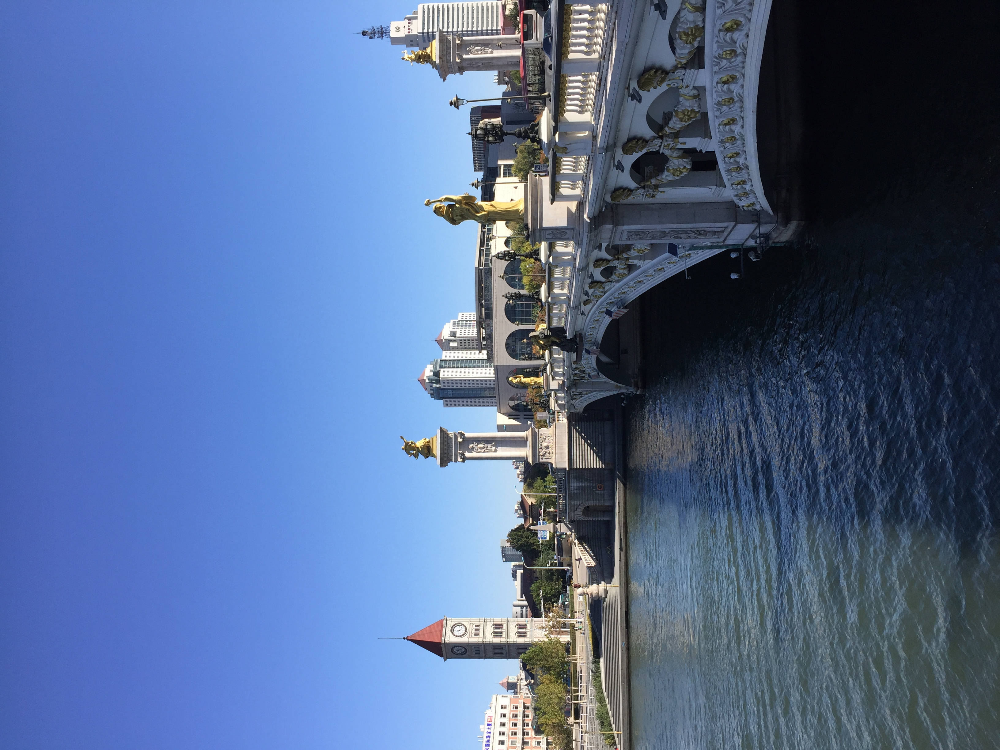

意大利风情街，像不像一堆小朋友向大叔脸上撒尿？哈哈哈哈哈
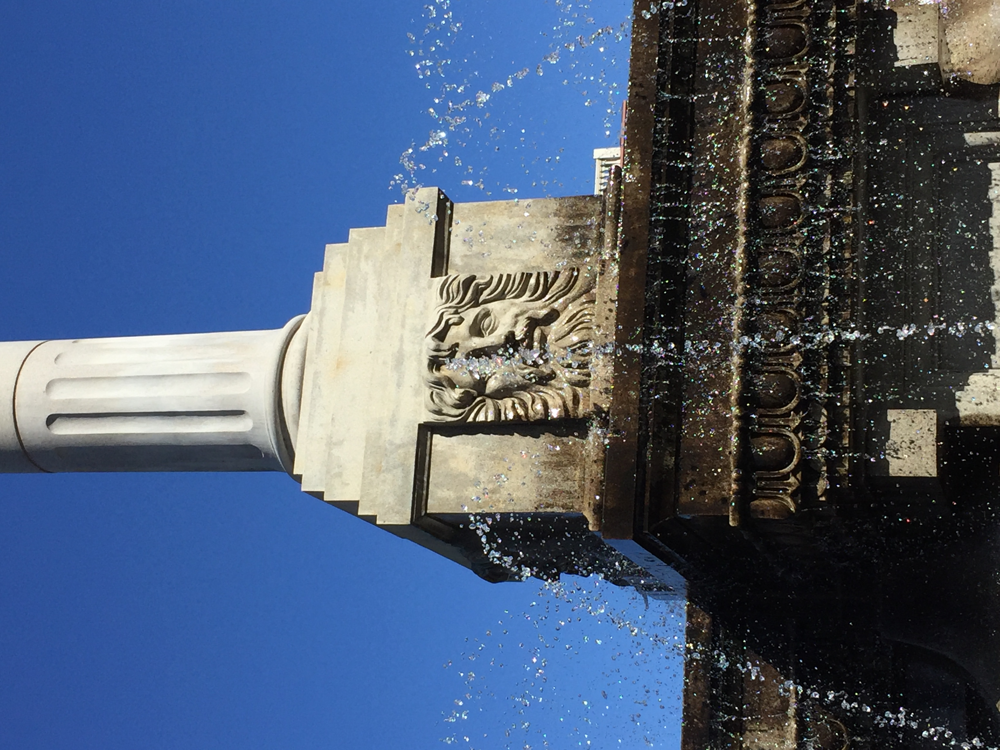

去了文化街，果然各个城市的文化街都是一个样子，以后出去玩再也不去这种地方了，千篇一律。失望之后我也没有去小吃街

吃过午饭后，直奔本次的主题。天津权健主场，海河教育园体育场。权健的气氛真的和某球队不同，没有对对手的谩骂，甚至在对手进了一记漂亮的远射后，全场响起掌声。为天津，赢天下
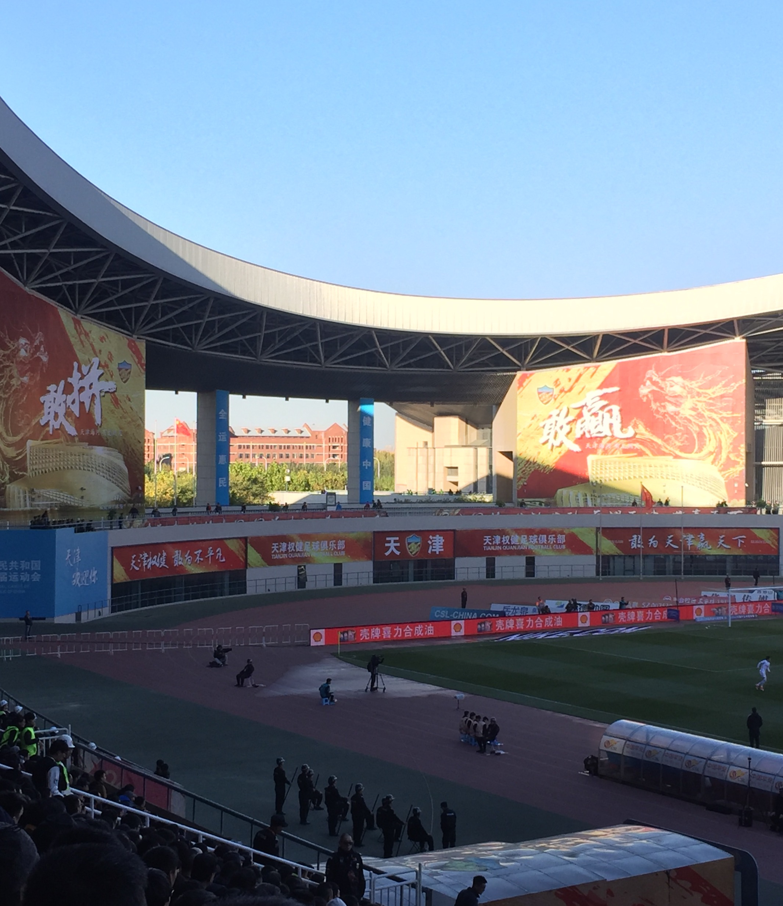
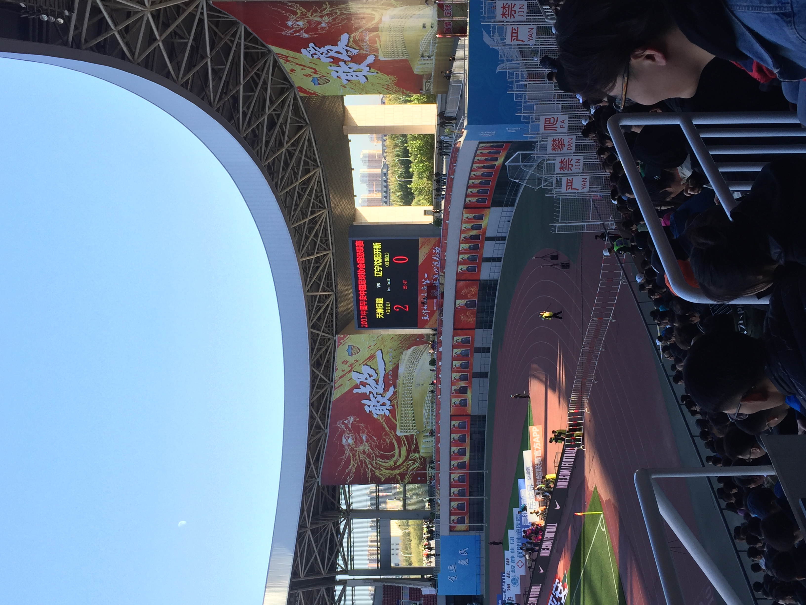
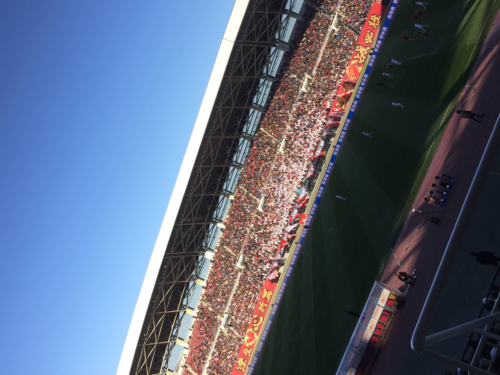

天津之眼！不评价太多，酷
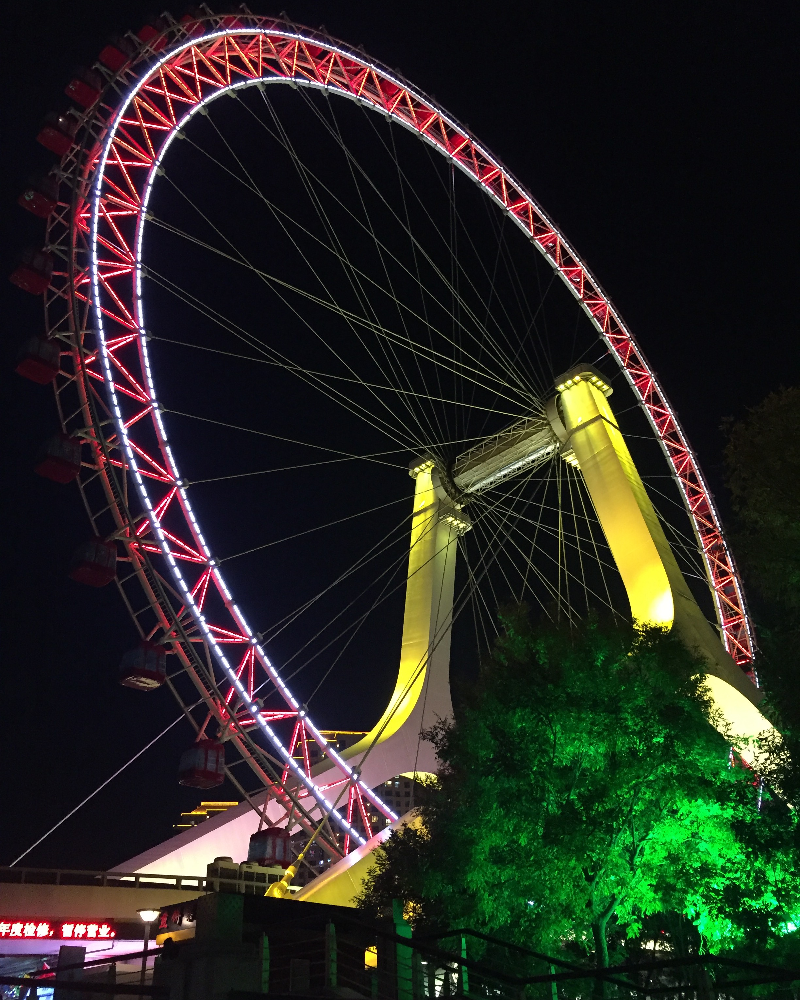
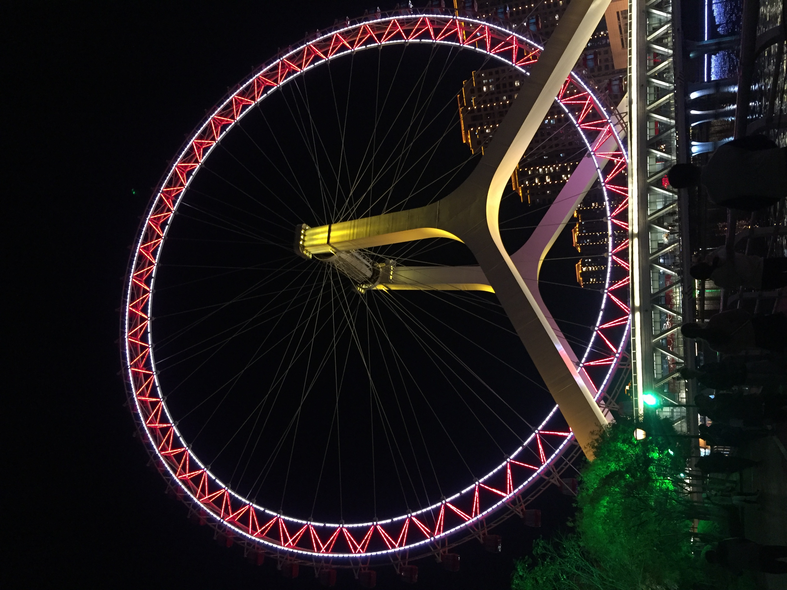

夜景也很好
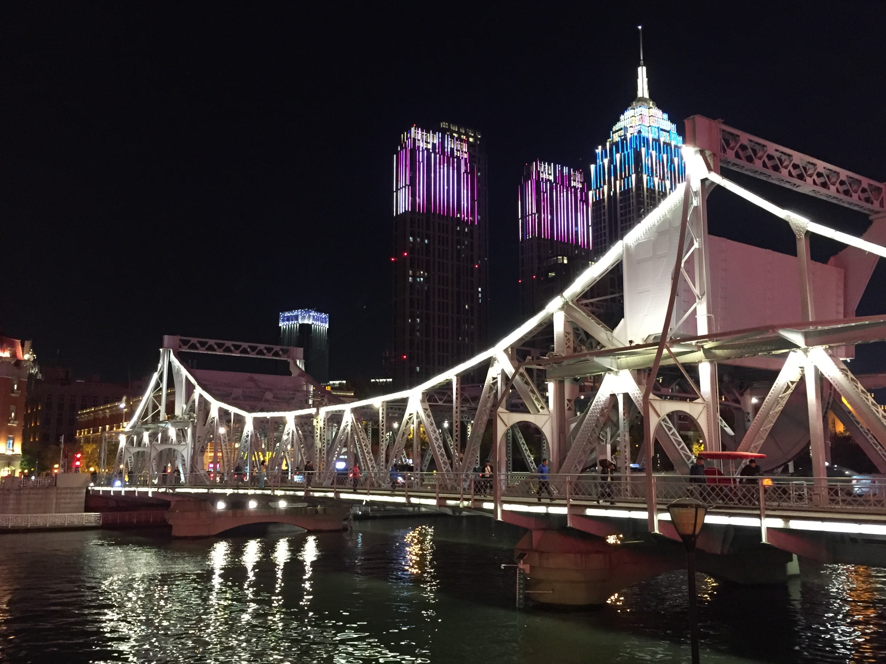
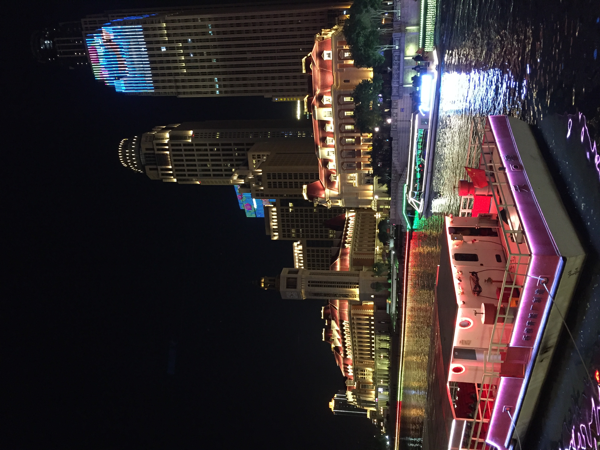
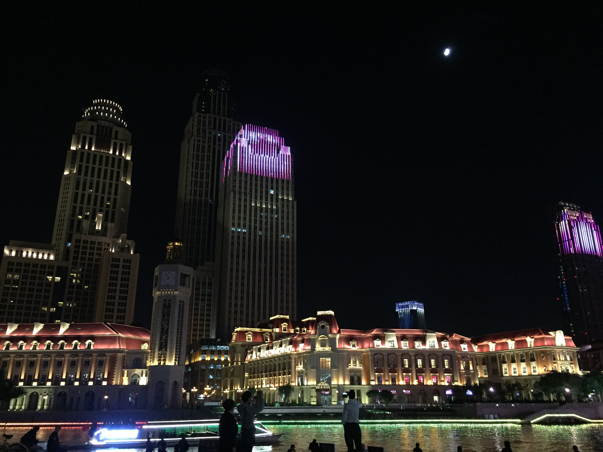

返程
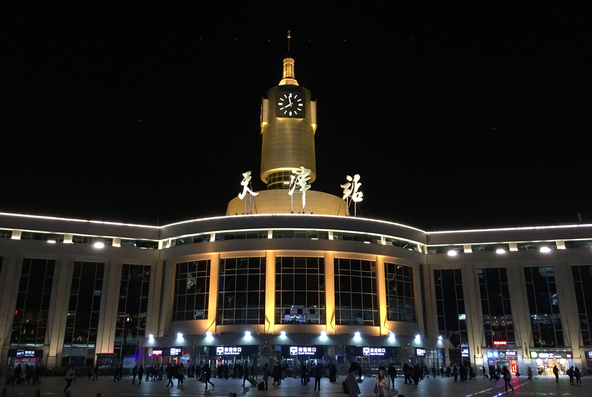
