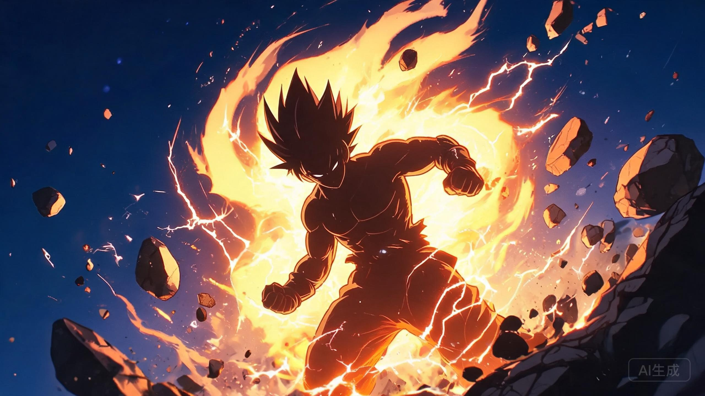

不是技术文，聊聊动漫。

小学放学冲回家，书包一甩就开电视——那时候的快乐很简单，悟空能不能赶上集气结束。二十多年过去，加班回家路上还是会戴起耳机重听那首《魔诃不思议大冒险》，DNA 动了。

## 为什么是龙珠

后来也追过很多热血番，但龙珠在我心里的位置很难被替代：

- **纯粹**。悟空想要的就是变强和变强，没有黑深残，没有圣母，干干净净；
- **败者的尊严**。贝吉塔一辈子活在「永远的第二名」里，却从未认输——成年后再看，这才是龙珠最狠的一条线；
- **留白式的燃**。那美克星的五分钟撑了几十集，气氛拉满时的「悟空变身」，没有一句废话。

## 一个不严谨的战斗力模型

龙珠迷都知道「战五渣」的梗——拉蒂兹落地时用战斗力探测器测出农民战五。既然如此，不如给悟空的战斗力建个模：

$$
P(t) = 5 \cdot e^{0.9t}
$$

其中 $P(t)$ 是悟空在 $t$ 年的战斗力，$5$ 是著名的初始值。看起来温和，但指数曲线的可怕之处在于：**前十年看不出区别，某一天突然就超赛了。**和很多成长型事情的规律一样，包括写代码。

当然，真实情况更夸张——弗利萨篇之后就只能用对数坐标画了。

## 最近还在追吗

《龙珠大魔》补完了，短篇体量，设定回收得很开心。剧场版里最爱的还是布罗利——战斗作画的天花板，影院里全场跟着气功波一起屏息的感觉，找回了小时候的电视机前。

> 战斗力只是数字，想变强的心才是超赛变身的条件。

下一个二十年，大概还会为同一个人喊「卡卡罗特」吧。
