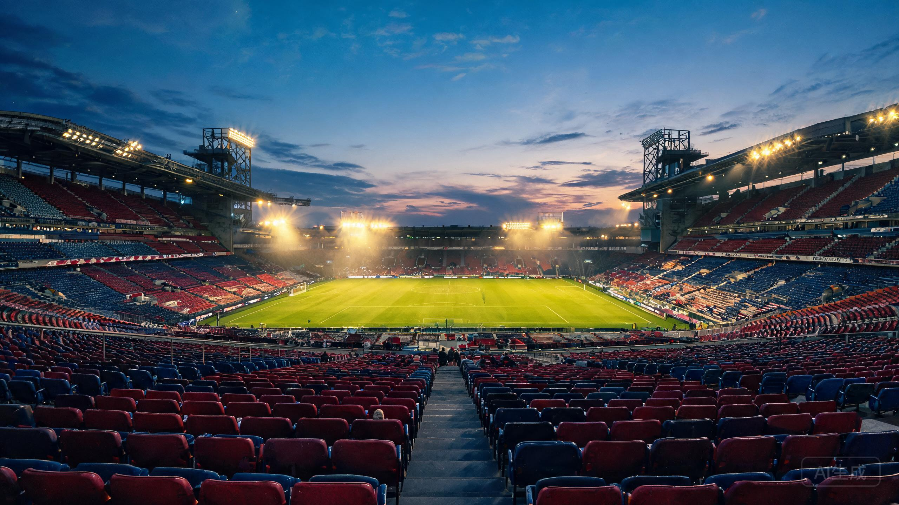

## 为什么还看球

朋友问过我：一场球九十分钟，还经常零比零，图什么？

**图的是确定性。**一周的班上下来，情绪是碎的；只有开球后的九十分钟，喜怒哀乐都简单直接——进球了就喊，丢球了就骂，特别解压。这套情绪按摩，别的活动替代不了。

巴塞罗那于我还有一层滤镜：**梦三王朝**是我看球的起点，tiki-taka 传控打法的观赏性，到现在都没找到平替。想了解那段历史，可以看[俱乐部官网的编年史](https://www.fcbarcelona.com/en/club/history)。

## 近况

新诺坎普在翻新，看台一点点换新模样；亚马尔横空出世，16 岁踢出 30 岁的从容。**传控的底色还在，只是换了一批人继续写。**

周末的固定流程也延续着：泡茶 → 关灯 → 开电视 → 解说员喊出「Barcelona」的那一刻，一周的疲惫清零。

> 球队会重建，球员会老去，但每个比赛日的黄昏，都和第一次看球时一模一样。

要看球的朋友，也欢迎读读我的[巴萨球衣收藏](/blog/barca-jerseys/)。
